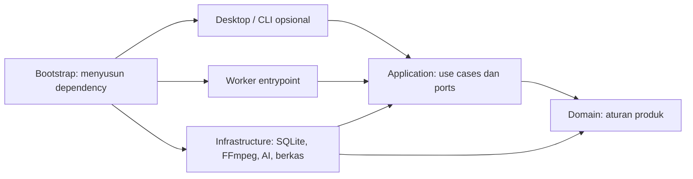

# Arsitektur Teknis Tool Desktop Pemrosesan Video

Status: Rancangan untuk implementasi MVP, belum berupa kode berjalan.  
Konteks produk: [RANCANGAN_VIDEO_EDITOR.md](RANCANGAN_VIDEO_EDITOR.md).

**Scope pertama:** ikuti [MVP_0.md](MVP_0.md). SQLite, migrasi, preset, revision, checkpoint, dan generator hook pada dokumen ini berlaku untuk MVP 1 atau setelahnya. MVP 0 memakai satu use case pemrosesan dan adapter Python sederhana tanpa database.

## 1. Keputusan arsitektur

Aplikasi desktop internal berbasis Python, berjalan pada satu komputer pengguna. UI memilih video dan preset, kemudian memanggil core pemrosesan yang menghasilkan paket konten lokal.

Gunakan satu paket aplikasi dengan batas modul yang jelas. Pemrosesan berat dijalankan oleh proses worker lokal yang terpisah dari proses UI. Clean architecture diterapkan melalui arah dependensi, interface adapter, dan aturan pemeriksaan kode.

## 2. Stack MVP

| Komponen | Teknologi | Tanggung jawab |
| --- | --- | --- |
| Bahasa | Python | Core, worker, dan antarmuka desktop |
| Desktop | PySide6 / Qt Widgets | Pilih video, preset, progres, koreksi teks, dan hasil |
| Preview hasil | Qt Multimedia | Memutar MP4 hasil; ketersediaan codec diperiksa pada target distribusi |
| Transkripsi | faster-whisper | Transkripsi lokal dengan timestamp |
| Pemrosesan media | FFmpeg + ffprobe | Metadata, audio, resize, latar blur, overlay, dan encoding |
| Subtitle render | ASS melalui FFmpeg/libass | Gaya, pembungkusan baris, dan posisi teks; ekspor SRT terpisah |
| Riwayat dan preset | SQLite + SQLAlchemy | Proses, langkah, artefak, revisi, dan preset pribadi |
| Migrasi data | Alembic | Perubahan schema yang tercatat sejak MVP |
| Hook dan caption | Adapter model bahasa | Input transkrip, output terstruktur dan tervalidasi |
| Berkas | Filesystem lokal | Direktori kerja, cache, sumber kerja, dan output |
| Paket output | `zipfile` | Paket hasil ZIP |
| Dependency proyek | `pyproject.toml` + lockfile | Instalasi yang dapat direproduksi |
| Pemeriksaan kode | Ruff + mypy + Import Linter | Gaya, tipe, dan batas dependensi |
| Validasi implementasi | pytest | Aturan produk, adapter, dan alur pemrosesan |

Versi dependency dikunci ketika implementasi dimulai setelah pemeriksaan kompatibilitas PySide6, Python, faster-whisper, dan OS target. Model transkripsi serta mode CPU/GPU dipilih berdasarkan kualitas dan kapasitas mesin, tanpa menjanjikan kecepatan sebelum diukur.

PySide6 adalah binding resmi Qt untuk Python. faster-whisper menyediakan transkripsi dengan timestamp, termasuk opsi timestamp kata jika diperlukan nanti. [Qt for Python](https://doc.qt.io/qtforpython-6/), [faster-whisper](https://github.com/SYSTRAN/faster-whisper).

Filter FFmpeg mendukung pemrosesan komposisi dan subtitle; build aplikasi harus memastikan dukungan libass dan font yang digunakan tersedia. [Dokumentasi FFmpeg](https://ffmpeg.org/ffmpeg-filters.html).

SQLite dipilih untuk penggunaan lokal pada satu mesin. SQLAlchemy ditempatkan di adapter persistence, dan Alembic mengelola migrasi. [SQLAlchemy](https://docs.sqlalchemy.org/en/20/orm/), [Alembic](https://alembic.sqlalchemy.org/en/latest/).

## 3. Empat lapisan dan aturan dependensi



Panah menunjukkan dependensi kode, bukan alur data.

| Lapisan | Berisi | Batas |
| --- | --- | --- |
| Domain | Entitas, value objects, aturan preset, rentang waktu, revisi, dan status | Python murni; tanpa Qt, SQLAlchemy, model AI, atau operasi berkas |
| Application | Use case, pipeline, port, dan DTO internal | Bergantung pada domain dan interface; tanpa import adapter konkret |
| Infrastructure | Repository SQLite, FFmpeg, faster-whisper, model bahasa, dan storage | Mengimplementasikan port dan memetakan data eksternal ke model internal |
| Presentation | Window, view model, validasi input UI, dan progres | Memanggil use case; tidak menjalankan SQL, FFmpeg, atau inference |

Bootstrap menjadi tempat menyusun adapter dan menyuntikkannya ke use case. Gunakan constructor injection; tidak diperlukan framework dependency injection.

Objek ORM dan objek Qt tidak melewati batas lapisan. Adapter memetakan keduanya ke dataclass/DTO internal. Kesalahan teknis dipetakan ke error aplikasi, lalu UI menampilkan pesan yang sesuai.

## 4. Struktur kode yang ditargetkan

```text
videogen/
  pyproject.toml
  src/videogen/
    domain/
      jobs.py
      presets.py
      transcripts.py
      render_specs.py
      errors.py
    application/
      ports/
      use_cases/
      pipeline.py
      dto.py
    infrastructure/
      persistence/
      media/
      transcription/
      copy_generation/
      storage/
      execution/
    presentation/
      desktop/
        windows/
        view_models/
        resources/
    bootstrap.py
    worker_main.py
    __main__.py
  migrations/
  tests/
    domain/
    application/
    integration/
    architecture/
  docs/adr/
```

Folder dibuat ketika ada implementasi yang menggunakannya. Hindari base class repository generik atau interface untuk setiap fungsi. Interface diperlukan pada batas I/O yang memang perlu diganti atau diisolasi.

## 5. Model dan use case

Model inti:

- `SourceMedia`: identitas sumber, fingerprint, metadata, dan referensi sumber kerja.
- `ProcessingJob`: input, snapshot preset, revision, status, dan langkah pemrosesan.
- `Transcript`: bahasa, segmen waktu, teks asli, dan versi koreksi.
- `GeneratedCopy`: pilihan hook, hook terpilih, caption, dan metadata generator.
- `Preset`: identitas, versi schema, rasio, gaya subtitle, hook, dan komposisi.
- `OutputVariant`: spesifikasi rasio, revision, status, dan artefak hasil.

Use case MVP:

- `CreateProcessingJob`, `RunProcessingJob`, `ResumeProcessingJob`, `CancelProcessingJob`.
- `GetJobResult`, `CorrectTranscript`, `SelectHook`, `ReprocessWithPreset`.
- `ListPresets`, `DuplicatePreset`, `SavePreset`, `DeletePreset`, `SetDefaultPreset`.
- `ExportPackage`.

Port yang diperlukan:

| Port | Implementasi awal |
| --- | --- |
| `JobRepository`, `PresetRepository` | SQLAlchemy/SQLite |
| `MediaProbe`, `AudioExtractor`, `VideoRenderer` | ffprobe/FFmpeg |
| `Transcriber` | faster-whisper |
| `CopyGenerator` | Adapter provider/model yang dipilih |
| `ArtifactStorage` | Direktori lokal |
| `ExecutionController` | Proses worker lokal |

`CopyGenerator` mengembalikan hook/caption dalam DTO yang divalidasi. Model dan provider masih perlu dipilih; ketersediaan interface tidak berarti fitur hook sudah bekerja. Kegagalan generator ditampilkan sebagai hasil sebagian, tanpa hook palsu.

## 6. Preset default dan preset pribadi

Preset bawaan disimpan sebagai resource JSON berversi di paket aplikasi. Preset pribadi serta ID default disimpan dalam SQLite. Domain memvalidasi ukuran, batas waktu hook, gaya, margin, dan pilihan output.

Usulan bawaan: Sosmed Vertikal, Minimal, Edukasi, dan Multi Format. Pengguna dapat mengganti preset pada dropdown, menduplikasi bawaan, menyimpan penyesuaian, dan menetapkan default.

Setiap job menyimpan **snapshot preset lengkap** beserta `schema_version`. Render membaca snapshot itu; perubahan pada preset asal tidak memengaruhi job berjalan atau hasil sebelumnya.

Pergantian preset pada hasil membuat revision baru. Artefak transkripsi dipakai ulang hanya jika fingerprint sumber, bahasa, model, dan pengaturan transkripsi cocok. Perubahan rasio atau gaya subtitle memicu render baru tanpa transkripsi ulang.

Konfigurasi provider, model, dan folder merupakan pengaturan aplikasi. Job mencatat snapshot konfigurasi pemrosesan yang relevan, tanpa menyalin credential ke preset atau metadata hasil.

## 7. Worker dan pemulihan proses

Alur: analisis sumber → ekstraksi audio → transkripsi → susun subtitle dan copy → render per rasio → paket hasil.

- Proses UI tetap menangani interaksi; satu proses worker menjalankan pipeline untuk MVP.
- Transkripsi dimuat di worker dan dapat dipakai kembali selama worker hidup.
- Render dijalankan melalui subprocess FFmpeg. Pengaturan awal membatasi satu pekerjaan berat pada satu waktu.
- Worker menyimpan status dan checkpoint ke SQLite; UI membaca progres secara berkala melalui use case query.
- Transaksi database singkat. Jangan menahan transaksi selama inference atau render.
- Setiap tahap menyimpan status, percobaan, revision, referensi artefak, dan error terakhir.
- Artefak ditulis ke file sementara, diperiksa, lalu dipindahkan ke nama final sebelum tahap ditandai selesai.
- Retry memeriksa identitas dan keberadaan artefak; file sebagian tidak dianggap hasil selesai.
- Setelah crash, job `running` hanya dinyatakan terhenti setelah memastikan worker pemilik sudah tidak aktif. Resume menggunakan checkpoint dan mengulang tahap yang belum selesai.
- Batalkan proses melalui sinyal kontrol; worker memeriksa pembatalan antartahap dan menghentikan subprocess render aktif. Operasi inference dapat perlu menunggu batas pembatalan yang tersedia.
- Menutup aplikasi saat ada job aktif menawarkan menunggu atau membatalkan. Proses worker dan subprocess tidak dibiarkan berjalan tanpa pengawasan.

SQLite menyimpan riwayat dan checkpoint; eksekusi MVP dikelola worker lokal. Antrean batch persisten dapat ditambahkan dengan use case dan adapter eksekusi setelah alur satu video stabil.

## 8. Berkas, revisi, dan render

```text
data/
  app.sqlite
  jobs/<job-id>/
    source/
    cache/
    revisions/<revision>/
      transcript.json
      transcript.txt
      subtitles.srt
      subtitles.ass
      copy.json
      outputs/
      manifest.json
```

- Lokasi data dapat dikonfigurasi. SQLite, model cache, dan media berada di disk lokal.
- Impor membuat salinan kerja agar sumber asli tidak ditimpa dan resume tidak bergantung pada file yang berpindah.
- Setiap revision memiliki output sendiri. Revision terbaru tidak mengganti hasil lama sebelum berhasil.
- Gunakan milidetik integer untuk waktu pada model internal; adapter mengubahnya ke format SRT/ASS/FFmpeg.
- Render dari satu `RenderSpec` yang tervalidasi: dimensi, durasi, gaya, hook, subtitle, dan posisi.
- Preview memutar MP4 hasil render, sehingga pengguna meninjau file yang benar-benar akan digunakan.
- Jalankan subprocess dengan daftar argumen dan `shell=False`; teks hook/subtitle ditulis ke file ASS dan di-escape sesuai format.
- Catat durasi tahap, model/provider, dan versi preset/render untuk diagnosis hasil.
- Pembersihan hanya menyasar berkas milik aplikasi. Riwayat memberi informasi jika artefak telah dihapus.

Tool internal tidak berarti semua AI otomatis lokal. Transkripsi dirancang lokal; pilihan model hook/caption menentukan apakah teks dikirim keluar. Pengaturan harus menjelaskan mode yang digunakan.

## 9. Menjaga clean architecture saat implementasi

Kriteria yang perlu dipenuhi kode MVP:

1. Import Linter menolak dependensi domain/application terhadap presentation dan infrastructure.
2. Domain dan use case dapat dijalankan tanpa Qt, database nyata, FFmpeg, atau unduhan model.
3. Adapter uji menggantikan batas I/O untuk memeriksa orkestrasi, retry, pembatalan, dan hasil sebagian.
4. Integrasi nyata memeriksa subtitle Indonesia, font, dimensi, sinkronisasi audio, dan hasil multi rasio.
5. Pemeriksaan restart memastikan checkpoint dapat dilanjutkan tanpa menggandakan hasil atau menimpa revision lama.
6. Pemeriksaan preset memastikan snapshot job tetap sama setelah preset pribadi diubah atau dihapus.
7. Ruff, mypy, migrasi database, dan kontrak adapter menjadi bagian pemeriksaan proyek.

Bagian ini adalah rencana validasi saat kode tersedia; belum ada implementasi atau pengujian yang dilakukan.

## 10. Tahapan pembangunan

1. **Fondasi:** paket Python, model domain, port, bootstrap, SQLite, migrasi, dan preset bawaan/pribadi.
2. **Pipeline nyata:** ffprobe, audio, faster-whisper, SRT/ASS, render satu rasio, dan checkpoint.
3. **Copy dan varian:** provider hook/caption terpilih, revision koreksi, beberapa rasio, dan ZIP.
4. **Desktop:** PySide6, pilih berkas/preset, progres, hasil, preview, dan koreksi teks; memanggil use case yang sama.
5. **Penyelesaian MVP:** pembatalan, resume, packaging OS target, serta kriteria penerimaan produk dan arsitektur.

Keputusan model hook/caption dan kapasitas mesin harus diselesaikan sebelum tahap terkait. Arsitektur memungkinkan penggantian UI, database, storage, dan AI melalui adapter, tetapi setiap penggantian tetap memerlukan implementasi dan pemeriksaan kontrak.
