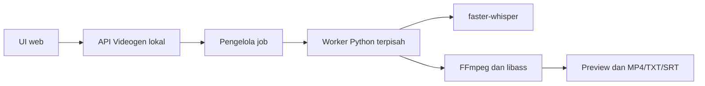

# Evaluasi OpenCut terbaru untuk Videogen

Tanggal evaluasi: 27 Oktober 2026. Lingkup: evaluasi kandidat fondasi web dan jalur integrasi; belum memigrasikan aplikasi Videogen.

## Hasil utama

Repo resmi terbaru memang [OpenCut-app/OpenCut](https://github.com/OpenCut-app/OpenCut). Pada commit `e668010778568641babef2cc40be4703ae6916d6`, aplikasi web masih kerangka awal: route `/editor` menampilkan judul **Editor** dan **Coming soon.** Mengadopsi commit ini belum memberi Videogen editor video yang siap dipakai.

Kesimpulan ini berasal dari checkout kode, bukan hanya status rewrite pada README. Changelog di repo menyebut fitur editor yang lebih lengkap, tetapi fitur dalam changelog tidak menjadi bukti bahwa implementasinya tersedia pada route dan source tree commit yang diperiksa.

## Versi dan bukti yang disimpan

- Repository: `https://github.com/OpenCut-app/OpenCut`.
- Branch yang di-checkout: `main`, shallow clone.
- Commit: `e668010778568641babef2cc40be4703ae6916d6`.
- Tanggal commit: 24 September 2026, `10:58:46 +0200`.
- Checkout evaluasi: `/tmp/videogen-opencut-eval-20261027` (sementara).
- [Manifest dan hash snapshot](diagnostics/opencut/2026-10-27/source-manifest.json).
- [Snapshot source](diagnostics/opencut/2026-10-27/source/) mempertahankan file yang mendasari temuan, dengan lisensi upstream.

Link kode upstream di bawah mengunci commit tersebut agar temuan tidak bergeser ketika `main` berubah.

## Matriks kebutuhan

| Kebutuhan Videogen | Temuan pada commit yang diperiksa | Status |
| --- | --- | --- |
| Halaman editor web | `/editor` hanya merender `Editor` dan `Coming soon.` | Kerangka tersedia; editor fungsional belum tersedia |
| Impor video MP4/MOV | Tidak ada alur file input, penyimpanan media, atau import ke proyek pada route web | Belum tersedia pada implementasi web yang diperiksa |
| Penataan hook/teks | Komponen UI generik tersedia, belum ada model objek teks dan interaksi editor | Belum tersedia |
| Subtitle dan timestamp per kata | Tidak ada alur caption/transkripsi pada source aplikasi web/API | Belum tersedia |
| Playback dan seek | Tidak ada player media pada route editor | Belum tersedia |
| Ekspor video | Tidak ada renderer/export pipeline yang terhubung ke aplikasi web | Belum tersedia |
| API integrasi | Endpoint `/`, `/health`, dan `/echo` | Kerangka API tersedia; kontrak editor belum tersedia |
| Engine media Rust | `crates/media` hanya berisi recipe setup dan manifest FFmpeg; tidak menjadi anggota workspace aktif | Belum membuktikan engine editor |
| Desktop | GPUI dengan panel bertuliskan Browser, Preview, Inspector, Timeline; README menyebut baru jendela awal | Belum menjadi alternatif editor siap pakai |

Sumber primer:

- [Route editor](https://github.com/OpenCut-app/OpenCut/blob/e668010778568641babef2cc40be4703ae6916d6/apps/web/src/routes/editor.tsx#L5-L12).
- [API](https://github.com/OpenCut-app/OpenCut/blob/e668010778568641babef2cc40be4703ae6916d6/apps/api/src/index.ts#L4-L15).
- [Cargo workspace](https://github.com/OpenCut-app/OpenCut/blob/e668010778568641babef2cc40be4703ae6916d6/Cargo.toml#L1-L6).
- [Recipe FFmpeg](https://github.com/OpenCut-app/OpenCut/blob/e668010778568641babef2cc40be4703ae6916d6/crates/media/setup/setup.ts#L84-L101).
- [Batas desktop](https://github.com/OpenCut-app/OpenCut/blob/e668010778568641babef2cc40be4703ae6916d6/apps/desktop/README.md).

Recipe FFmpeg upstream menonaktifkan executable dan avfilter (`--disable-programs`, `--disable-avfilter`, `--disable-autodetect`). Karena itu hasil build recipe tersebut belum dapat menggantikan binary FFmpeg dengan filter ASS dan encoder libx264 yang dipakai Videogen. Tidak menjalankan download/build FFmpeg atau kompilasi desktop karena keduanya tidak membuktikan fitur web yang belum terhubung.

## Verifikasi runtime

Catatan runtime dan hasil perintah disimpan dalam [runtime.json](diagnostics/opencut/2026-10-27/runtime.json). Status source, build, respons HTTP, dan browser harus dibaca terpisah. Build berhasil tidak berarti alur impor sampai ekspor berhasil.

| Pemeriksaan | Hasil |
| --- | --- |
| Install dependency frontend | Lulus: 656 paket, `bun install` selesai dengan exit code 0 |
| Build client dan SSR | Lulus: `bun run build`, exit code 0; ada warning sourcemap CSS |
| Startup dev server | Lulus di luar sandbox, bind ke `127.0.0.1:5188` |
| HTTP `/editor` | Lulus HTTP 200; HTML SSR berisi heading `Editor` dan paragraf `Coming soon.` |
| Modul komponen editor yang dilayani Vite | Lulus HTTP 200; komponen hasil code splitting tetap berisi `Coming soon.` |
| Impor, edit teks/subtitle, playback, ekspor, integrasi Whisper | Belum tersedia pada implementasi web yang diperiksa; bukan pengujian fitur yang lulus |
| Interaksi browser, screenshot | Tidak tersedia pada sesi ini |
| macOS dan Windows | Belum diuji |

Bukti: [log build](diagnostics/opencut/2026-10-27/build.txt), [header HTTP](diagnostics/opencut/2026-10-27/editor-http-headers.txt), [HTML aktual](diagnostics/opencut/2026-10-27/editor-http.html), dan [komponen yang dilayani](diagnostics/opencut/2026-10-27/editor-component.js).

Environment evaluasi memakai Node `v24.16.0` dan Bun `1.3.6` yang sudah tersedia, menjalankan script paket web langsung. Toolchain upstream mematok Bun `1.3.11`; `proto`/`moon` tidak dipasang. Repo tidak menyertakan lockfile JavaScript pada commit ini dan beberapa dependency memakai `latest`. Versi yang terselesaikan, [lockfile evaluasi](diagnostics/opencut/2026-10-27/resolved-bun.lock), dan [perubahan route tree hasil generator](diagnostics/opencut/2026-10-27/generated-route-tree.diff) disimpan agar hasil tidak disalahartikan sebagai build dengan seluruh toolchain upstream yang dipatok. Tidak mengedit source produk upstream secara manual.

Browser automation tidak tersedia pada sesi evaluasi: inventori browser kosong dan pembuatan tab in-app mengembalikan `Browser is not available: iab`. Tidak mengklaim screenshot, pengujian interaksi browser, atau keberhasilan pada macOS/Windows.

## Jalur integrasi yang masuk akal

Arsitektur berikut merupakan rancangan integrasi, bukan fitur yang sudah dibangun atau dibuktikan pada OpenCut:

Videogen sudah memiliki batas integrasi yang dapat dipakai kembali:

| Fungsi | Source saat ini | Rencana penghubung web |
| --- | --- | --- |
| Transkripsi | `worker_main.py --operation transcribe --source ... --output ...` | Terima video, jalankan job, baca event JSONL stdout, kembalikan ID proyek |
| Draft | `application/projects.py:save_draft` dan `normalize_draft` | Simpan snapshot hook, subtitle, dan edit timeline berdasarkan ID proyek |
| Preview | `worker_main.py --operation preview --project ... --request ...` | Buat request snapshot server-side, layani preview yang sesuai request terbaru |
| Render | `worker_main.py --operation render --project ... --request ...` | Render snapshot yang telah diterapkan, layani revisi hasil setelah selesai |
| Progress/error | Event `ready`, `stage`, `completed`, `failed`, `cancelled` di stdout worker | Petakan ke status job dan polling atau SSE; simpan stderr/log terpisah |

Kontrak API awal yang diusulkan:

- `POST /api/projects`: menerima video dan memulai transkripsi; hasil `202` dengan `job_id`.
- `GET /api/jobs/{job_id}`: tahap, progress, hasil atau error.
- `POST /api/jobs/{job_id}/cancel`: membatalkan worker dan proses anaknya.
- `GET /api/projects/{project_id}`: transkrip, timestamp kata, metadata, draft.
- `PUT /api/projects/{project_id}/draft`: validasi dan simpan draft.
- `POST /api/projects/{project_id}/previews`: buat preview berdasarkan snapshot.
- `POST /api/projects/{project_id}/renders`: buat revisi output dari snapshot.
- `GET /api/projects/{project_id}/artifacts/{artifact_id}`: layani media/hasil yang dipetakan server.

Path filesystem diselesaikan server berdasarkan ID, bukan menerima path bebas dari browser. Mulai dengan satu job aktif, backend terikat ke loopback, dan sumber video yang dimiliki direktori proyek. Untuk playback, sediakan media yang mendukung HTTP range; buat proxy H.264/AAC bila codec sumber tidak didukung browser. Browser dapat menampilkan overlay interaktif, tetapi frame FFmpeg tetap menjadi pemeriksaan tampilan akhir sampai parity terbukti.

## Pekerjaan portabilitas yang tetap diperlukan

1. Keluarkan loader playback libopenshot Linux dari jalur web; playback web memakai player browser.
2. Pertahankan PySide6 secara headless pada awal migrasi karena `infrastructure/fonts.py` masih memvalidasi dan mengukur font melalui Qt. Menghapus UI desktop tidak otomatis menghapus dependency Qt dari backend.
3. Pastikan FFmpeg/ffprobe dengan ASS/libx264 tersedia per OS; recipe media OpenCut saat ini belum memenuhi kontrak tersebut.
4. Kelola model dan font secara eksplisit; font yang sama harus dipakai saat pengukuran, preview, dan render.
5. Ganti lokasi data/cache/log yang mengikuti Linux dengan lokasi sesuai OS. Hindari bergantung pada path checkout untuk instalasi pengguna.
6. Rancang dan uji pembatalan seluruh proses anak pada Windows dan macOS. Fallback `QProcess.terminate()` pada desktop sekarang belum membuktikan penghentian FFmpeg di semua OS.
7. Petakan media/font pada proyek dengan ID atau path relatif terkelola agar proyek tidak bergantung pada absolute path mesin asal.

UI web lokal masih memerlukan backend terpasang di mesin pengguna. Jika targetnya hanya membuka URL tanpa instalasi Python/FFmpeg, backend harus disediakan sebagai layanan; video ditransfer dan komputasi berpindah ke server. Deployment layanan bersama bukan bagian evaluasi ini.

## Rekomendasi setelah evaluasi source

**Jangan memigrasikan Videogen ke commit rewrite ini dengan asumsi akan mendapat editor siap pakai.** Pada snapshot yang diperiksa, implementasi kebutuhan utama masih harus dibangun.

Repo terbaru tetap relevan untuk diikuti dan dievaluasi kembali ketika route editor, model proyek, playback, dan export pipeline tersedia. Belum ada alasan dari kode saat ini untuk menyimpulkan bahwa menunggu atau memelihara fork rewrite lebih ringan daripada membangun UI web tipis di atas worker Videogen.

Jika pengembangan web dilanjutkan, potongan pertama yang terukur adalah impor satu video, transkripsi, satu hook, subtitle ber-highlight, preview FFmpeg, dan ekspor. Pertahankan format serta aplikasi desktop saat ini sampai potongan tersebut lulus. Pemilihan Classic sebagai fork adalah keputusan terpisah dengan beban pemeliharaan sendiri; evaluasi ini tidak mengganti kandidat ke Classic.

Syarat kelulusan prototipe migrasi berikutnya:

- Video uji dapat ditranskripsikan tanpa menghilangkan timestamp kata dan offset audio/video.
- Hook/subtitle dapat diedit dan disimpan; preview lama tidak menimpa snapshot terbaru.
- Font, wrapping, posisi, stroke, clipping, dan highlight sesuai frame output.
- Ekspor menghasilkan MP4, TXT, SRT; render ulang tidak menjalankan transkripsi lagi.
- Pembatalan/penutupan tidak menyisakan worker atau FFmpeg dan tidak merusak hasil sukses sebelumnya.
- Alur tersebut diuji pada Windows dan macOS; keberhasilan di Linux saja belum cukup untuk klaim lintas platform.

Evaluasi ini hanya menambah laporan dan arsip bukti. Source aplikasi serta dependency Videogen tidak diubah.
