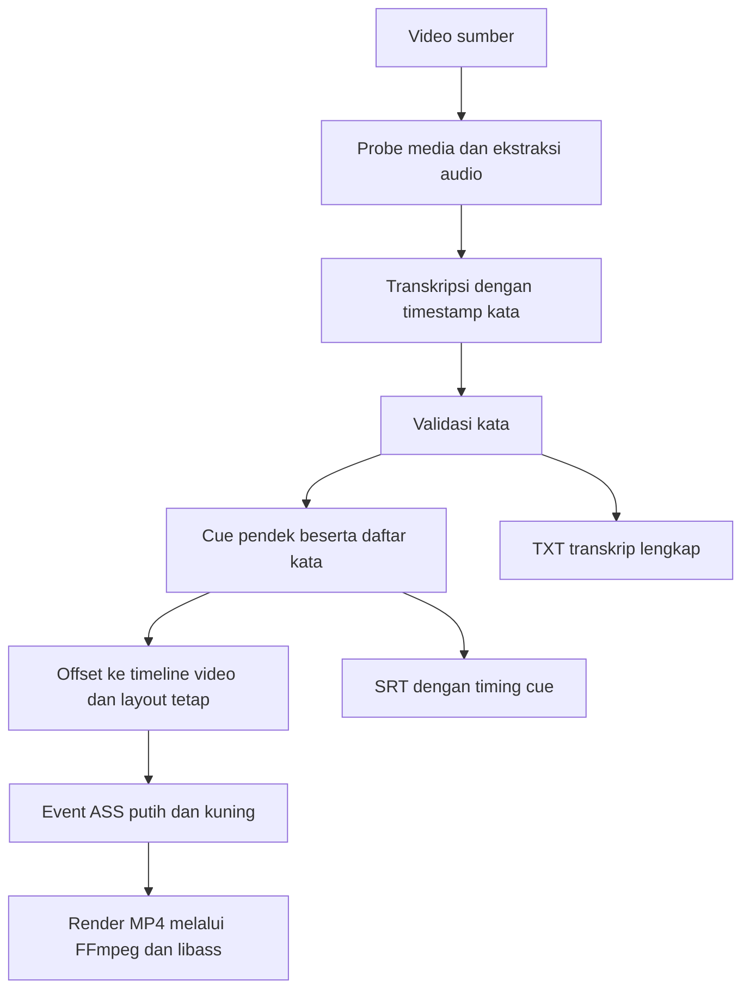

# MVP 1 — Subtitle dengan Highlight Kata Aktif

Status: implementasi MVP 1 dan pemeriksaan terarah tersedia pada 9 Oktober 2026. Perilaku subtitle dan tampilan dasar telah disetujui pengguna. Bukti serta batas pemeriksaan dicatat pada [laporan verifikasi](MVP_1_VERIFICATION.md); akurasi timestamp terhadap batas ucapan kata memerlukan penilaian audio tersendiri.

## 1. Tujuan

Menghasilkan video dengan subtitle singkat yang mudah dibaca: Helvetica Neue Bold, teks putih dengan stroke gelap tipis, dan kata yang sedang diucapkan berubah menjadi kuning. Setelah ucapan kata selesai, warna kembali putih.

MVP 1 melanjutkan alur desktop MVP 0: pilih video, pilih folder hasil, tekan **Proses**, lalu buka hasil. Input MP4/MOV SDR dan output MP4, TXT, serta SRT mengikuti kontrak pipeline yang sudah digunakan.

## 2. Acuan visual dan perilaku

Referensi pengguna menampilkan frasa `win one job`, dengan `win one` putih dan `job` kuning. Subtitle berada di tengah secara horizontal, lebih tinggi daripada posisi subtitle MVP 0. Font terlihat tebal; Helvetica Neue ditetapkan dari spesifikasi pengguna.

| Keadaan | Tampilan |
| --- | --- |
| Kata sedang diucapkan | Kata tersebut kuning; kata lain pada cue putih |
| Kata selesai diucapkan | Kata kembali putih |
| Jeda di antara kata dalam cue | Seluruh cue putih |
| Pergantian kata | Highlight berpindah tanpa mengubah posisi atau pembungkusan teks |
| Cue berakhir | Seluruh cue menghilang |
| Hanya timestamp segmen tersedia | Teks segmen putih; tidak membuat timing kata perkiraan |

Seluruh frasa terlihat sejak awal cue sampai akhir cue. Highlight berubah langsung pada batas timestamp, tanpa animasi sapuan warna. Interval aktif menggunakan `start <= waktu < end`.

## 3. Gaya tetap

Nilai berikut berasal dari implementasi yang telah disetujui sebagai dasar visual.

| Parameter | Nilai |
| --- | --- |
| Font | Helvetica Neue, Bold |
| Warna normal | Putih, `#FFFFFF` |
| Warna kata aktif | Kuning, `#FFFF00` |
| Stroke | Gelap, `#101010` |
| Ukuran font | `max(18, round(min(0.045 × H, 0.08 × W)))` |
| Ketebalan stroke | `max(1, round(0.025 × ukuran_font, 2))` |
| Pusat subtitle | `(0.5 × W, 0.74 × H)` |
| Area aman horizontal | 8% lebar pada setiap sisi |
| Shadow | Tidak digunakan |
| Baris | Utamakan satu baris; maksimal dua baris |

`W` dan `H` adalah dimensi tampilan setelah memperhitungkan orientasi sumber. Posisi mengacu pada pusat blok teks, bukan baseline atau batas bawah huruf. Ukuran dan stroke memakai koordinat ASS yang mengikuti dimensi frame.

Untuk kata panjang, grup kata yang bertumpang tindih, atau fallback segmen yang tidak muat, ukuran per cue boleh dikurangi hingga minimum 18 piksel dengan stroke yang dihitung ulang. Jika masih tidak muat maksimal dua baris dalam area aman, proses gagal dengan pesan jelas, tanpa memotong teks.

## 4. Pembagian cue

1. Bentuk cue dari urutan kata hasil transkripsi.
2. Pecah sebelum kata berikutnya bila terdapat batas kalimat, jeda minimal 0,65 detik, atau penambahan kata melampaui batas cue.
3. Batas awal: empat kata, target durasi 2,5 detik, dan jumlah karakter `min(24, max_line_characters(info))`.
4. Awal cue mengikuti kata pertama; akhir cue mengikuti kata terakhir.
5. Tentukan pembungkusan satu kali untuk setiap cue sebelum menghasilkan event warna.

Batas durasi dan jumlah kata mengatur penggabungan kata. Satu kata panjang atau fallback satu segmen dapat melampaui batas tersebut; jangan memotong teks atau membagi timing berdasarkan jumlah karakter.

Jumlah karakter menjadi batas awal penggabungan. Layout final diukur dengan `QFontMetricsF` memakai file Helvetica Neue Bold yang sama dengan render, termasuk lebar glyph dan stroke. Bila cue melewati area aman pada ukuran awal, pecah cue pada batas grup kata yang waktunya tidak bertumpang tindih. Kata tunggal panjang dibungkus pada batas karakter dengan aksen gabungan tetap melekat; fallback segmen dibungkus tanpa menciptakan timestamp kata. Pembungkusan eksplisit ASS menggunakan `WrapStyle: 2` agar libass tidak menyusun ulang baris.

## 5. Alur data dan render

Kontrak data yang dipakai:

| Model | Data |
| --- | --- |
| `Word` | `text`, `start`, `end`, `has_word_timing` |
| `Cue` | `text`, `start`, `end`, `words` |
| `MediaInfo` | Dimensi tampilan, durasi, awal audio/video, dan `subtitle_offset` |

Timestamp hasil transkripsi berada pada timeline audio. Validasi awal hanya menyaring teks kosong dan waktu tidak valid, tanpa clipping ke durasi video. Saat menyusun cue, terapkan `audio_start - video_start` pada setiap kata, lalu batasi ke durasi video. TXT mempertahankan transkrip audio lengkap. Kata hasil fallback segmen diberi `has_word_timing=False`.

Renderer membentuk batas event dari awal/akhir cue dan kata. Setiap event menampilkan frasa lengkap dengan layout yang sama; hanya tag warna kata aktif yang berubah. Event yang bersebelahan dan memiliki tampilan sama digabung. Serialisasi ASS memakai presisi 10 ms; interval yang menjadi nol setelah pembulatan tidak dirender.

Jika timestamp kata bertumpang tindih dalam satu cue, kata dengan waktu mulai paling akhir menjadi aktif. Pada waktu mulai yang sama, urutan ucapan dipertahankan dan kata yang lebih akhir dalam cue mendapat prioritas. Grup kata yang bertumpang tindih tidak dipisah menjadi cue berbeda, termasuk ketika melewati batas empat kata atau target 2,5 detik. Akhir cue mengikuti nilai akhir terbesar seluruh kata; tidak memotong kata yang masih aktif. Layout memvalidasi bahwa cue hasil tidak bertumpang tindih.

ASS menjadi file kerja untuk MP4 dan dihapus setelah proses selesai. SRT menyimpan teks biasa dan timing cue. TXT menyimpan transkrip lengkap. Output tidak menjanjikan highlight pada pemutar SRT.

## 6. Font dan setup

Implementasi lokal memakai `.cache/fonts/helvetica-neue/HelveticaNeueBold.otf`. `VIDEOGEN_FONT_PATH` dapat menunjuk file Helvetica Neue lain. FFmpeg menerima folder file font tersebut sebagai `fontsdir`; style meminta keluarga `Helvetica Neue` dengan weight Bold.

Font lokal telah diunduh dari [Font.Download](https://font.download/font/helvetica-neue-5). Halaman sumber mencantumkan penggunaan personal. File berada di cache yang diabaikan Git dan tidak masuk paket aplikasi. Metadata unduhan tersimpan pada `.cache/fonts/HelveticaNeue-SOURCE.txt`.

Setup dan validasi yang tersedia:

- [README](README.md#setup-font) menyediakan cara memakai font lokal maupun unduhan untuk preview personal.
- Sebelum transkripsi, `SubtitleFont` memeriksa keterbacaan file, font TrueType/OpenType valid, family Helvetica Neue, weight 700, dan style non-italic.
- File font yang tidak tersedia atau tidak cocok menghasilkan pesan dependency yang jelas.
- Qt harus mengukur file font yang tervalidasi; karakter yang tidak didukung ditolak agar tidak memakai fallback font.
- FFmpeg memuat salinan hanya file font tervalidasi dari folder kerja sementara. Log mencatat `fontselect`; nama PostScript hasil harus cocok, atau paket hasil tidak diterbitkan.
- Untuk distribusi, tetapkan penyediaan font sesuai lisensi; pembelian atau bundling bukan bagian dari persetujuan visual ini.

## 7. Pemetaan komponen

| File | Tanggung jawab |
| --- | --- |
| `src/videogen/domain/models.py` | Kata bertimestamp, cue pendek, offset, dan ukuran awal subtitle |
| `src/videogen/infrastructure/whisper.py` | Timestamp kata dan penanda fallback segmen |
| `src/videogen/infrastructure/subtitles.py` | Layout, style, event highlight ASS, TXT, dan SRT |
| `src/videogen/infrastructure/fonts.py` | Validasi file/family/weight, metadata PostScript, dan pengukuran teks |
| `src/videogen/infrastructure/ffmpeg.py` | Penyediaan folder font dan render MP4 |
| `src/videogen/application/process_video.py` | Urutan proses, artefak, dan penerbitan hasil |
| `src/videogen/worker_main.py` | Penyusunan dependency dan path font |

## 8. Kriteria penerimaan

1. Kata aktif kuning; kata lain putih; tidak ada kata yang tetap kuning setelah intervalnya berakhir.
2. Jeda di dalam cue menampilkan seluruh frasa putih, tanpa pergeseran teks atau baris.
3. Helvetica Neue Bold benar-benar digunakan oleh libass; stroke dan posisi mengikuti tabel gaya.
4. Kata/cue tidak terpotong, keluar frame, atau menimpa cue lain pada portrait dan landscape.
5. Timing highlight mengikuti ucapan pada sampel awal, tengah, dan akhir video nyata. Catat selisih yang diukur; target awal maksimal sekitar 200 ms pada ucapan yang jelas, sebagai target evaluasi, bukan hasil yang telah terbukti.
6. Offset audio/video diterapkan pada setiap kata; interval berada dalam durasi video.
7. Fallback segmen tetap menghasilkan teks terbaca tanpa highlight kata palsu.
8. MP4, TXT, dan SRT tersedia dalam paket hasil; sumber tidak ditimpa dan kegagalan tidak menerbitkan hasil sebagian.
9. Instalasi baru memiliki langkah setup font yang dapat diikuti dan pesan jelas ketika dependency belum tersedia.

## 9. Status dan pekerjaan penyelesaian

| Bagian | Status |
| --- | --- |
| Timing kata dipertahankan pada cue | Sudah diimplementasikan |
| Highlight kuning dan jeda putih | Sudah diimplementasikan; pemeriksaan sintetis lulus |
| Font, stroke, posisi, dan cue pendek | Sudah diimplementasikan; arah visual disetujui pengguna |
| Pemilihan Helvetica Neue Bold oleh libass | Terbukti pada render sintetis lokal |
| Pipeline video nyata dan sinkronisasi audio hasil terhadap sumber | Lulus; lihat laporan verifikasi |
| Akurasi timestamp terhadap batas ucapan kata | Belum diukur terhadap anotasi ucapan independen |
| Lebar teks dari font yang digunakan | Pengukuran font tersedia; pemeriksaan piksel portrait/landscape lulus |
| Offset, overlap antarcue, dan akhir kata bertumpang tindih | Diperbaiki; tes regresi lulus |
| Validasi family/weight font saat startup | Tersedia, termasuk file rusak dan style non-italic |
| Font yang benar-benar dipilih libass | Dicatat dan diperiksa pada proses aplikasi |
| Setup font pada instalasi baru | Langkah font lokal/unduhan tersedia di README |

Implementasi dan pemeriksaan otomatis yang sudah tersedia dicatat pada [laporan verifikasi](MVP_1_VERIFICATION.md). Pemeriksaan akurasi batas ucapan kata menggunakan klip awal, tengah, dan akhir yang disiapkan dari video nyata; jangan menyimpulkan akurasi pengenal ucapan dari korelasi audio hasil terhadap sumber.

MVP 1 selesai ketika kriteria penerimaan terpenuhi dan langkah setup dapat dipakai ulang. Roadmap produk yang lebih luas tetap merujuk ke [rancangan video editor](RANCANGAN_VIDEO_EDITOR.md).
