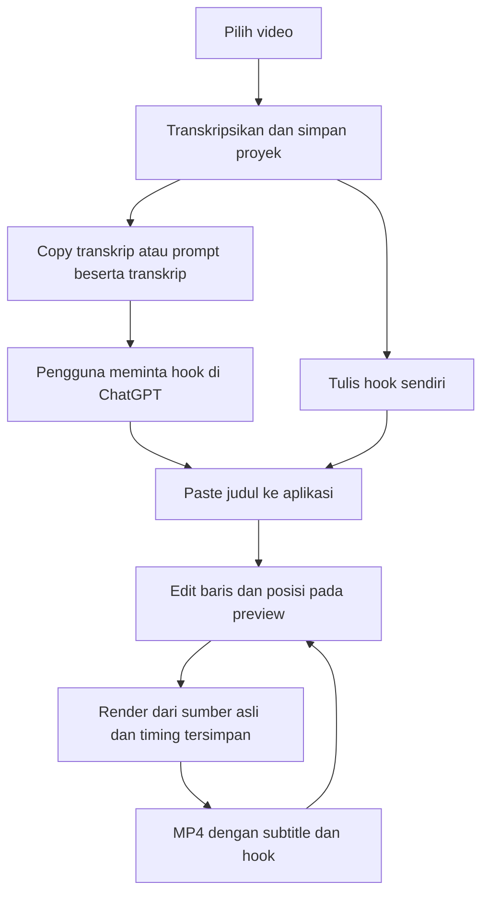

dis# MVP 2 — Hook Text melalui Copy dan Paste ChatGPT

Status: fitur dasar MVP 2 dan penyederhanaan UI tiga tahap sudah diimplementasikan. Pemeriksaan implementasi awal dicatat pada Bagian 14, dan pemeriksaan UI pada Bagian 15. Kenyamanan penggunaan, tampilan pada layar aktual pengguna, validasi unggahan Reels, serta akurasi onset kata masih memerlukan evaluasi pengguna.

Revisi editor gaya hook dan preset default pada Bagian 16 telah diimplementasikan setelah perintah `gas`. Status pemeriksaan revisi ini ada pada Bagian 17; pemeriksaan runtime dan visual masih `pending`.

Editor langsung pada halaman Hook dan kontrol preview pada Bagian 18 telah diimplementasikan setelah perintah `gas` berikutnya. Bagian 19 mencatat pemeriksaan dan evaluasi yang masih pending. Bagian 18 menggantikan aturan penempatan editor dan perpindahan sesi pada Bagian 16; Bagian 17 tetap merupakan catatan implementasi dialog sebelumnya.

Revisi editor hook visual yang fleksibel pada Bagian 20 telah diimplementasikan setelah perintah `gas` berikutnya. Bagian 21 mencatat pemeriksaan implementasi serta evaluasi runtime/visual yang masih pending. Bagian 20 menggantikan ketentuan sebelumnya yang bertentangan.

Revisi WYSIWYG hook/subtitle, progress proses, dan folder hasil pada Bagian 22–24 telah diimplementasikan setelah `gas`. Bagian 25 mencatat perubahan dan batas bukti; pemeriksaan runtime/visual tetap pending.

Koreksi drag yang dirancang pada Bagian 26 telah diimplementasikan setelah `gas`. Bagian 27 mencatat perubahan, pemeriksaan statis, dan bukti runtime yang masih pending.

## 1. Tujuan

Pengguna mengambil transkrip video dari aplikasi, menyalinnya ke ChatGPT untuk menghasilkan judul hook berdasarkan konteks ucapan, lalu menempelkan judul ke aplikasi. Pengguna dapat meminta sudut hook tertentu kepada ChatGPT maupun menulis atau mengubah judul langsung di aplikasi.

Hook ditampilkan di bagian atas video, memakai Helvetica Neue Bold, huruf kapital, teks hitam, dan latar putih. Panjang tampilan satu sampai tiga baris, dengan ukuran serta penempatan yang mudah dibaca dan tidak terlalu menutupi orang.

ChatGPT menerima transkrip melalui tindakan pengguna. Aplikasi menghasilkan prompt dan menerima teks hook; tidak memerlukan integrasi akun atau API ChatGPT untuk alur ini. Konteks yang diberikan berasal dari ucapan, sehingga prompt tidak boleh mengarang detail visual yang tidak disebutkan dalam transkrip.

## 2. Alur pengguna

1. Pilih video dan folder hasil.
2. Klik **Transkripsikan video**. Worker mengekstrak audio, membuat transkrip dan timing kata, lalu menyimpan proyek lokal yang siap dirender.
3. Baca transkrip di aplikasi. Klik **Copy transkrip** untuk teks murni, atau **Copy prompt + transkrip** untuk instruksi hook beserta transkrip lengkap.
4. Tempel ke ChatGPT. Jika membutuhkan hook tertentu, isi arahan sebelum menyalin prompt atau tulis permintaan tambahan langsung di ChatGPT.
5. Tempel judul hasil ke kolom **Hook title**. Teks yang diketik sendiri memakai kolom yang sama.
6. Periksa preview: huruf kapital, satu sampai tiga baris, ukuran panel putih, posisi terhadap wajah, dan jarak dari tepi video. Pengguna bisa mengubah pemenggalan baris dan posisi vertikal.
7. Klik **Render video**. Aplikasi menggabungkan hook dan subtitle MVP 1 dari video sumber asli.
8. Buka video hasil atau folder hasil. Mengubah hook lalu merender kembali menggunakan transkripsi yang sudah tersimpan dan menghasilkan revisi baru.

Worker tidak menunggu selama pengguna berinteraksi dengan ChatGPT. Transkripsi dan render menjadi pekerjaan terpisah; proyek tetap tersedia selama jeda copy/paste atau jika render gagal.



## 3. Copy transkrip dan permintaan hook

### Dua tombol dengan isi yang jelas

| Kontrol | Perilaku |
| --- | --- |
| **Copy transkrip** | Menyalin transkrip lengkap tanpa timestamp, prompt, atau pemotongan |
| **Arahan hook** | Kolom opsional untuk sudut tertentu, pertanyaan, bahasa, tone, atau judul yang diinginkan |
| **Copy prompt + transkrip** | Menyalin prompt standar, arahan opsional, serta seluruh transkrip |
| Status setelah copy | Menampilkan “Transkrip disalin” atau “Prompt dan transkrip disalin” |

Tombol copy aktif setelah transkripsi berhasil. Transkrip pada MVP 2 ditampilkan sebagai teks yang dapat dibaca dan dipilih; penyuntingan isi transkripsi beserta timing bukan bagian dari perubahan hook ini.

### Prompt bawaan

```text
Saya ingin membuat judul hook untuk video pendek berdasarkan transkrip berikut.

Pahami topik utama, masalah atau ketegangan yang dibahas, dan manfaat yang akan didapat penonton. Buat SATU judul hook yang menarik perhatian dan membuat orang ingin melanjutkan menonton.

Ketentuan:
- Hook harus sesuai konteks dan isi transkrip.
- Gunakan rasa penasaran, masalah yang relevan, atau manfaat yang spesifik.
- Jangan mengarang fakta, angka, janji, atau detail visual.
- Gunakan bahasa yang sama dengan transkrip, kecuali arahan saya meminta bahasa lain.
- Usahakan singkat, sekitar 6–12 kata, agar nyaman ditampilkan dalam 1–3 baris.
- Tulis dalam HURUF KAPITAL.
- Berikan hanya judul final, tanpa penjelasan, alternatif, penomoran, tanda kutip, atau Markdown.

Arahan khusus saya:
{arahan pengguna, atau “Tidak ada; pilih hook yang paling kuat berdasarkan transkrip.”}

TRANSKRIP VIDEO:
{transkrip lengkap}
```

Contoh arahan khusus: “Fokuskan hook pada biaya tersembunyi merekrut karyawan baru. Gunakan nada penasaran.” Bagian transkrip diperlakukan sebagai bahan sumber, bukan instruksi yang menggantikan prompt di atas.

Target 6–12 kata merupakan panduan untuk ChatGPT; validasi aplikasi menggunakan lebar dan tinggi teks yang terukur. Permintaan khusus pengguna tetap perlu sesuai fakta transkrip. Jika pengguna ingin judul tertentu secara persis, ia dapat menulisnya langsung pada **Hook title**.

Respons yang ditempelkan adalah judul final. Aplikasi menampilkan teks yang akan dirender, sehingga pengguna dapat menghapus penjelasan atau alternatif jika ChatGPT memberikan format lain. Aplikasi tidak menebak mana judul yang benar dari respons panjang dan tidak mengubah makna judul secara diam-diam.

## 4. Tampilan desktop

### Gap UI setelah implementasi awal

Pengguna melaporkan tampilan terlalu banyak dan membingungkan. Inspeksi kode menunjukkan seluruh tahap ditumpuk dalam satu halaman scroll: pemilihan sumber/proyek, transkrip, pengaturan hook, preview, render, serta evaluasi. Pengguna harus menentukan sendiri urutan tindakan dan berpindah scroll untuk menghubungkan editor dengan preview.

| Gap | Dampak | Usulan penanganan |
| --- | --- |
| Pilih video, proyek, folder/log, transkripsi, dan batal tampil sejajar | Tindakan pertama tidak menonjol | Tampilkan satu tindakan utama sesuai tahap; batal hanya muncul saat proses berjalan |
| Transkrip, editor, pengaturan, preview, dan hasil bertumpuk panjang | Pengguna harus scroll antara edit dan hasil | Editor dan preview berdampingan dengan tombol render dekat editor |
| Dua tombol copy memiliki bobot sama | Pilihan copy menambah keputusan | Utamakan Salin prompt untuk ChatGPT; salin transkrip murni menjadi opsi tambahan |
| Pengaturan posisi, pemenggalan, dan durasi langsung terlihat | Terlalu banyak keputusan sebelum mencoba | Gunakan default dan kelompok Pengaturan hook yang dapat dibuka |
| Paste hook jauh dari editor | Hubungan tombol dengan kolom kurang jelas | Letakkan Paste hook tepat di atas editor |
| Log/evaluasi sejajar dengan tindakan utama | Tampilan menjadi ramai dan teknis | Pindahkan ke menu Lainnya pada tahap hasil |
| Petunjuk proses dan autosave memakai label status yang sama | Draft tersimpan dapat menutupi petunjuk berikutnya | Pisahkan status simpan kecil dari petunjuk langkah dan progress |
| Slider preview tanpa waktu dalam detik | Bagian video yang diperiksa kurang jelas | Tampilkan waktu saat ini/durasi, misalnya 00:02 / 00:50 |

### Usulan alur tiga tahap

Status: penyederhanaan UI sudah diimplementasikan. Satu jendela menampilkan tahap aktif **Video → Hook → Hasil**, dengan nama tahap dan petunjuk tindakan berikutnya yang jelas.

| Tahap | Tampilan utama | Tindakan utama dan tambahan |
| --- | --- | --- |
| **1. Video** | Pilih video, nama file, dan ringkasan folder hasil | Sebelum memilih sumber: Pilih video. Setelah sumber valid: Buat transkrip. Buka proyek menjadi pilihan sekunder; ubah folder hasil berada pada opsi tambahan |
| **2. Hook** | Salin prompt untuk ChatGPT, Paste hook di atas editor, editor judul, serta preview di sampingnya | Saat judul belum tersedia: Salin prompt untuk ChatGPT. Setelah judul dan preview terbaru valid: Render video. Pengguna juga dapat langsung menulis judul tanpa ChatGPT |
| **3. Hasil** | Nama revisi/video terbaru dan status selesai | Buka video sebagai tindakan utama; Edit hook lagi sebagai tindakan sekunder. Folder hasil/proyek, log, dan Catat evaluasi / keluhan tersedia melalui Lainnya |

Selesai transkripsi membawa pengguna ke tahap Hook. Membuka proyek tersimpan membawa pengguna ke tahap Hook dengan draft yang dipulihkan. Selesai render membawa pengguna ke tahap Hasil. Edit hook lagi kembali ke tahap Hook tanpa transkripsi ulang. Gagal/dibatalkan tetap memberi akses ke tahap yang masih valid beserta alasan dan tindakan retry.

Pada tahap Hook, transkrip lengkap dapat dibuka lewat **Lihat transkrip**; salin teks murni tersedia di sana. Arahan khusus tetap tersedia sebagai kolom opsional dekat tombol salin prompt. Petunjuk singkat menjelaskan bahwa pengguna menempelkan prompt ke ChatGPT lalu kembali untuk paste judul.

Pengaturan hook disembunyikan pada kelompok yang dapat dibuka, dengan ringkasan default **Otomatis · 5 detik · Posisi 15%**. Kelompok ini memuat pemenggalan otomatis/manual, durasi pembuka/sepanjang video, posisi vertikal, dan Tampilkan hook. Ringkasan mengikuti nilai draft dan durasi efektif yang dibatasi durasi sumber. Mode manual tetap menjelaskan bahwa newline editor menentukan baris.

Editor, preview, dan tombol render harus dapat dilihat bersama pada layar desktop pengguna. Transkrip lengkap dan pengaturan tambahan tidak memaksa pengguna scroll untuk mencapai tindakan utama. Preview mempertahankan rasio video, dilengkapi waktu dalam detik dan penanda durasi hook. Layout diperiksa pada ukuran jendela serta skala tampilan aktual pengguna; jika ruang terbatas, prioritaskan editor, preview, dan tindakan utama serta batasi scroll pada konten tambahan.

Petunjuk langkah, progress proses, status preview, dan status autosave mempunyai tempat terpisah. Status simpan ditampilkan kecil dekat editor; kegagalan simpan tetap terlihat dan dapat ditindaklanjuti. Tombol render yang nonaktif menampilkan alasan singkat dekat tombol, misalnya **Isi judul hook**, **Preview sedang diperbarui**, atau **Perbaiki pemenggalan judul**. Progress dan tombol Batalkan proses tampil selama transkripsi/render berlangsung.

Editor menerima paste standar melalui Ctrl+V dan menyediakan tombol **Paste hook** yang membaca clipboard saat diklik. Judul yang diketik langsung tidak memerlukan clipboard. Field memakai teks biasa; judul tidak diperlakukan sebagai HTML atau kode ASS.

Pilihan **Tampilkan hook** aktif secara default. Bila dimatikan, pengguna dapat merender subtitle MVP 1 tanpa hook. Bila aktif, judul kosong atau layout tidak valid membuat tombol render tidak aktif dengan alasan di dekat editor.

Mengganti video menghapus hubungan transkrip/hook dengan sumber lama dan meminta transkripsi sumber baru. Proyek lama tetap tersimpan pada foldernya. Tombol copy memakai transkrip proyek aktif, bukan hasil video sebelumnya.

### Kriteria penerimaan penyederhanaan UI

Kriteria berikut menjadi acuan perbaikan UI. Hasil pemeriksaan teknis dicatat pada Bagian 15; kemudahan mengenali langkah masih perlu dinilai oleh pengguna:

1. Tahap aktif dan tindakan berikutnya dapat dikenali tanpa membaca petunjuk di luar aplikasi; satu tindakan utama menonjol sesuai keadaan.
2. Alur memilih video, membuat transkrip, salin prompt/paste atau menulis judul, preview, dan render dapat diselesaikan dengan default tanpa membuka Pengaturan hook.
3. Editor, preview, dan render terlihat bersama pada ukuran layar/jendela pengguna yang diuji.
4. Paste hook berdekatan dengan editor; copy transkrip murni dan pengaturan tambahan tetap dapat ditemukan melalui label yang jelas.
5. Status autosave tidak menggantikan petunjuk langkah/progress; setiap tombol render nonaktif mempunyai alasan terlihat.
6. Slider menampilkan waktu saat ini dan durasi video dalam detik; interval hook efektif terlihat.
7. Buka video, edit kembali, buka proyek, render tanpa hook, evaluasi, log, dan folder hasil tetap dapat diakses dari tahap/menu yang sesuai.
8. Navigasi tahap, kegagalan, pembatalan, dan kembali mengedit mempertahankan draft/proyek serta identitas revisi yang benar.

## 5. Gaya dan penempatan hook

### Acuan screenshot pengguna

Referensi terbaru menampilkan hook berikut dalam dua baris:

```text
ONE JOB COVERS TWO YEARS.
BUT THAT’S NOT THE REAL COST.
```

Teks rata tengah, hitam, uppercase, dan tebal. Latar putih mengikuti lebar masing-masing baris dengan sudut membulat; panel baris pendek tidak perlu selebar panel baris panjang. Blok berada di atas kepala dengan jarak dari tepi atas. Screenshot menjadi acuan bentuk dan komposisi, bukan bukti identitas font, durasi tampil, atau safe zone resmi Reels.

### Nilai awal yang diusulkan

Angka berikut merupakan default rancangan yang perlu diperiksa pada video pengguna. Ini bukan klaim ukuran safe zone resmi Instagram.

Nilai ini menjadi gaya bawaan. Usulan editor pada Bagian 16 memungkinkan pengguna mengubah gaya hook dan menyimpan preset; perubahan font hook tidak mengubah font subtitle MVP 1.

| Parameter | Usulan |
| --- | --- |
| Font | Helvetica Neue Bold non-italic, memakai file tervalidasi MVP 1 |
| Teks | Huruf kapital, `#000000` |
| Latar | Panel putih opak, `#FFFFFF`, mengikuti lebar masing-masing baris, dengan sudut membulat kecil |
| Baris | Satu sampai tiga baris |
| Alignment | Tengah secara horizontal, teks rata tengah |
| Lebar maksimum setiap panel baris | 84% lebar frame, termasuk padding |
| Tepi atas blok default | 15% tinggi frame; rentang awal 12%–15% dapat dipakai untuk mencocokkan referensi melalui preview |
| Tinggi maksimum seluruh blok | 14% tinggi frame, termasuk padding dan jarak antarbaris |
| Ukuran font minimum | `font_min = max(18, ceil(0.022 × H))`, sekitar 2,2% tinggi frame |
| Ukuran font awal | `max(font_min, round(min(0.03 × H, 0.06 × W)))` |
| Padding awal | Horizontal 1% lebar frame; vertikal 0,5% tinggi frame |
| Jarak antarbaris | Sekitar 10% ukuran font, diperiksa dari metrik font |
| Stroke dan shadow teks | Tidak digunakan |
| Posisi manual | Tepi atas blok dapat digeser di area 12%–30% tinggi frame; seluruh blok harus tetap muat |

`W` dan `H` mengikuti dimensi tampilan sumber, sesudah orientasi diperhitungkan. Koordinat menyatakan tepi panel, sehingga menambah baris tidak membuat baris pertama bergeser ke atas dan mendekati tepi frame.

Panel putih dibuat rapat terhadap masing-masing baris, bukan banner selebar video. Semua panel baris terpusat pada sumbu horizontal yang sama. Panel yang bersentuhan boleh membentuk bidang putih menyambung seperti referensi. Ukuran panel, sudut membulat, serta seluruh glyph harus berada di dalam batas layout. Hook dan subtitle merupakan blok terpisah dan tidak boleh saling menimpa.

Batas minimum relatif menjaga keterbacaan ketika video ditampilkan pada layar ponsel. Jika judul tidak muat pada ukuran minimum, pengguna diminta memendekkan hook; aplikasi tidak terus mengecilkan teks hanya agar lolos batas panel. Angka ukuran dan posisi tetap default usulan yang diperiksa saat implementasi diizinkan.

### Keterbacaan dan wajah

- Preview menampilkan frame hasil FFmpeg dengan hook dan subtitle dari ASS gabungan yang sama dengan render final, lalu menyesuaikan skala untuk ukuran widget.
- Pengguna dapat menggeser waktu preview sepanjang interval hook untuk memeriksa gerakan orang, bukan hanya frame pertama.
- Posisi dapat digeser vertikal sambil tetap mengikuti batas frame dan area yang disediakan.
- Jika panel menutupi wajah, pengguna dapat mengubah posisi, memendekkan hook, atau mengatur durasi tampil.
- Pemeriksaan mencakup awal, tengah, dan akhir interval hook serta frame tambahan saat orang bergerak. Hindari menutup mata, mulut, atau bagian wajah yang menjadi fokus video.
- Jika posisi yang tersedia tetap menutupi wajah, pendekkan judul atau kurangi jumlah baris sebelum mencoba posisi lagi. Aplikasi tidak menjamin seluruh video memiliki ruang kosong yang cukup untuk hook.
- MVP 2 menggunakan pemeriksaan preview oleh pengguna; tidak menjanjikan deteksi wajah atau penghindaran wajah secara otomatis.

Panduan margin mengurangi risiko teks terlalu dekat tepi. Penampilan pada Reels masih perlu diperiksa di preview unggahan karena UI platform dan crop tampilan dapat berbeda. Sumber portrait 9:16 menjadi target pemeriksaan Reels. Untuk sumber dengan rasio lain, preview aplikasi mengikuti rasio sumber; tidak menjanjikan aman setelah platform melakukan crop ke 9:16.

Halaman resmi Meta tentang safe zone telah dicoba saat analisis, tetapi diarahkan ke login sehingga ketentuan detailnya tidak dapat diverifikasi dari akses ini. Karena itu, angka di atas tetap usulan aplikasi. Referensi yang perlu diperiksa saat validasi unggahan: [Meta — text overlays dan safe zone](https://www.facebook.com/business/help/980593475366490).

### Mekanisme preview

Preview memakai sumber asli, timestamp yang dipilih, subtitle tersimpan, dan snapshot `HookLayout`. ASS dan font yang dipakai harus sama dengan render final; preview tidak menggambar ulang teks dengan renderer UI yang berbeda.

Perubahan judul, baris, posisi, durasi, atau waktu preview dijadwalkan setelah jeda singkat, dengan usulan debounce 300 ms. Ekstraksi frame berlangsung asynchronous melalui proses terpisah agar editor tetap responsif. Request preview mempunyai identitas; hasil request lama tidak boleh mengganti preview untuk draft yang lebih baru. Resize widget hanya mengubah skala tampilan frame, bukan koordinat layout sumber.

Status preview dibedakan menjadi memperbarui, siap, atau gagal. Bila draft terbaru belum memiliki preview yang sesuai, tampilkan status tersebut agar pengguna tidak mengira frame lama mewakili edit terbaru. Frame juga dapat dipilih sesudah interval hook untuk memeriksa bahwa hook sudah menghilang.

## 6. Pemenggalan judul

1. Simpan teks editor asli pada draft. Untuk tampilan, ubah teks menjadi uppercase sebelum mengukur layout; normalisasi newline CRLF/CR menjadi LF.
2. Mode **Otomatis** menggabungkan whitespace dan memilih pemenggalan pada batas kata untuk satu, dua, atau tiga baris menggunakan font aktual.
3. Pada mode otomatis, evaluasi pembagian satu, dua, dan tiga baris. Prioritaskan ukuran font terbesar yang muat; kandidat dengan ukuran sama dinilai menurut urutan pada langkah 5.
4. Ukuran font awal pada tabel gaya menjadi batas maksimum. Pencarian ukuran hanya bergerak turun hingga `font_min`; tidak membesarkan teks melampaui ukuran awal untuk judul pendek.
5. Pemenggalan otomatis memakai heuristik sederhana, bukan pemahaman bahasa: di antara kandidat dengan ukuran font sama, utamakan batas setelah tanda baca, lalu hindari baris terakhir yang hanya berisi satu kata pendek (maksimal tiga karakter), lalu minimalkan selisih lebar baris. Kandidat yang tetap setara memakai jumlah baris lebih sedikit, kemudian urutan batas kata dari kiri ke kanan agar hasil deterministik. Pengguna dapat memperbaiki pemenggalan melalui mode manual.
6. Mode **Manual** mempertahankan newline pengguna; hanya spasi di dalam tiap baris dan tepi teks yang dinormalisasi. Baris kosong di tengah atau lebih dari tiga baris menghasilkan pesan yang meminta perbaikan baris, bukan penghapusan newline diam-diam.
7. Jika layout tidak muat, kurangi ukuran font hingga `font_min` pada tabel gaya sambil tetap mempertahankan isi dan jumlah baris manual.
8. Jika tetap tidak muat pada tiga baris dan batas panel, minta pengguna memendekkan judul. Jangan memotong teks, menambahkan ellipsis, atau mengarang pembagian waktu untuk judul panjang.

Validasi mempertimbangkan padding, jarak baris, glyph yang melewati advance width, dan tinggi panel. Preview menggunakan hasil layout yang sama dengan serializer render; bukan perhitungan kedua yang bisa menghasilkan baris berbeda.

Untuk editor gaya tambahan, Bagian 16 menggantikan aturan ukuran pada langkah 4 dan 7: batas atas mengikuti ukuran yang diminta, dan pengecilan hanya dilakukan pada mode Otomatis agar muat. Mode Ukuran tetap tetap memakai algoritma pemenggalan yang dipilih, tetapi menolak layout yang tidak muat pada ukuran tersebut.

## 7. Durasi tampil

Usulan default: **lima detik pertama**, dibatasi durasi video bila sumber lebih pendek. Pengguna bisa memilih **Pembuka** dengan durasi numerik, atau **Sepanjang video**. Screenshot tidak menunjukkan durasi tampil; default ini merupakan usulan rancangan.

Durasi pembuka harus berupa angka positif dan finite. Durasi nol, negatif, atau tidak valid membuat render tidak aktif dengan pesan di dekat kontrol. Nilai yang melebihi durasi video dibatasi ke akhir video dan interval efektif ditampilkan pada UI. Mode sepanjang video memakai durasi sumber tanpa input angka tambahan.

Hook selalu dimulai pada detik 0 untuk MVP 2. Hook pembuka menghilang pada akhir interval; hook sepanjang video menghilang saat video selesai. Tidak diperlukan fade atau animasi masuk. Subtitle berjalan mengikuti timing MVP 1 selama video berlangsung.

## 8. Penyimpanan proyek dan render ulang

Transkripsi disimpan sebelum pengguna beralih ke ChatGPT. Satu proyek lokal menyimpan:

```text
<folder-hasil>/<nama-video>_project_<id>/
  project.json
  transcript.txt
  words.json
  draft.json
  diagnostics.jsonl
  evaluation.json
  revisions/
    <revision-id>/
      <nama-video>_subtitled.mp4
      <nama-video>_subtitled.txt
      <nama-video>_subtitled.srt
      hook.txt
      render.json
```

| Data | Isi yang dibutuhkan |
| --- | --- |
| `project.json` | `schema_version: 1`, identitas proyek, path sumber, fingerprint SHA-256, metadata media, konfigurasi transkripsi, dan referensi artefak |
| `words.json` | Teks, start/end pada timeline audio, dan `has_word_timing` setiap kata |
| `draft.json` | Arahan prompt, teks judul asli, hook aktif/tidak, mode pemenggalan, posisi, mode/durasi tampil, dan versi prompt |
| `hook.txt` | Judul final beserta pemenggalan baris yang dirender; kosong jika hook dimatikan |
| `render.json` | Snapshot hook, durasi, posisi, ukuran/layout final, referensi sumber, dan versi gaya subtitle |
| `diagnostics.jsonl` | Event proses dan evaluasi dengan waktu, identitas operasi/proyek/revisi, status, dan referensi bukti; tetap tersedia setelah kegagalan atau pembatalan |
| `evaluation.json` | Daftar pemeriksaan, status terbaru, metode, hasil pengukuran atau observasi, dan referensi bukti untuk revisi yang diperiksa |

Artefak transkripsi diterbitkan secara utuh setelah tahap transkripsi selesai. Menutup aplikasi saat menunggu hook tidak menghilangkannya. Tombol **Buka proyek** memuat proyek tersebut kembali; ini cukup untuk kelanjutan sesi tanpa menambahkan daftar riwayat atau database.

Draft disimpan otomatis setelah perubahan editor atau pengaturan dengan jeda singkat. Penulisan memakai file sementara yang diganti secara atomik. Saat menutup aplikasi atau berpindah proyek, perubahan terakhir disimpan terlebih dahulu; kegagalan simpan ditampilkan agar pengguna mengetahui draft belum tersimpan. Buka proyek memulihkan arahan, judul, pemenggalan, posisi, dan durasi sebelum menghasilkan preview baru. `draft.json` adalah pekerjaan yang masih dapat diedit; `render.json` merupakan snapshot revisi yang sudah dibekukan.

Setiap render memakai sumber asli dan timing tersimpan. MP4 yang sudah diberi subtitle tidak menjadi input render ulang, agar teks tidak berlapis dan video tidak mengalami encoding berulang dari hasil sebelumnya. Sumber harus tersedia dan sesuai fingerprint; bila berubah, aplikasi meminta transkripsi baru.

Fingerprint menggunakan SHA-256 seluruh isi sumber, bukan hanya nama atau modification time. Hash dicatat saat transkripsi dan sumber diperiksa kembali sebelum render. Saat membuka proyek, validasi schema, referensi artefak, metadata wajib, serta timestamp yang finite dan memiliki `end > start`. Timestamp audio disimpan tanpa clipping ke durasi video; konversi offset dan clipping mengikuti MVP 1. Proyek rusak atau schema yang tidak didukung menghasilkan pesan jelas dan tidak diteruskan ke render.

Mode render hanya memakai proyek, timing kata tersimpan, font, dan FFmpeg. Model Whisper tidak dimuat pada mode ini. Mengubah judul, posisi, baris, atau durasi tidak menjalankan inference; proyek yang valid tetap dapat dirender ketika model transkripsi tidak tersedia.

Proyek menyimpan konfigurasi subtitle MVP 1 yang digunakan, termasuk offset audio-ke-video, batas cue, posisi, warna, stroke, ukuran/layout, dan versi algoritma gaya. Identitas font mencakup family, PostScript name, dan SHA-256 file font. Setiap `render.json` membekukan konfigurasi serta identitas font tersebut bersama snapshot hook. Render ulang memakai konfigurasi tersimpan; perubahan versi yang tidak kompatibel atau font berbeda harus dijelaskan sebelum render, bukan diterapkan diam-diam.

Revisi memakai staging dan nama unik. Hasil sebelumnya tetap tersedia ketika render berikutnya gagal. File ASS gabungan menjadi file kerja untuk render dan dapat dibersihkan setelah revisi berhasil, karena timing dan spesifikasi layout yang diperlukan telah tersimpan.

## 9. Model dan pembagian tanggung jawab

Model yang diusulkan:

| Model | Isi |
| --- | --- |
| `TranscriptProject` | Identitas proyek, sumber/fingerprint, metadata media, word timestamps, dan konfigurasi transkripsi |
| `HookSpec` | Aktif/tidak, teks pengguna, mode pemenggalan, posisi vertikal, serta mode/durasi tampil |
| `HookLayout` | Baris final uppercase, ukuran font, bounds teks/panel per baris, sudut membulat, padding, dan interval tampil |
| `RenderRevision` | Snapshot subtitle dan hook serta path hasil revisi |

Pembagian komponen:

| Komponen | Rancangan perubahan |
| --- | --- |
| Desktop | Panel transkrip, clipboard, editor hook, preview asynchronous, buka proyek, autosave draft, dan dua tahap kerja |
| Application | Pisahkan use case transkripsi dan render; susun prompt; validasi proyek dan snapshot revisi |
| Domain | Kontrak proyek/hook/layout dan kebijakan durasi; tetap tanpa dependency UI |
| Font adapter | Gunakan validasi serta metrik Helvetica Neue Bold yang sudah tersedia |
| Subtitle/ASS adapter | Gabungkan event subtitle, panel putih hook, dan teks hook hitam berdasarkan `HookLayout` |
| FFmpeg adapter | Tetap satu render dari sumber asli melalui ASS gabungan; fontselect tetap diverifikasi |
| Worker | Mode transkripsi yang memuat Whisper dan mode render yang hanya membaca proyek tersimpan |

Panel putih per baris dengan sudut membulat dapat dibuat dengan drawing ASS pada layer terpisah di belakang teks hook. Koordinat panel dan teks berasal dari `HookLayout` yang sama. Isi pengguna di-escape sebagai teks; tidak menjadi tag atau drawing ASS.

UI membaca artefak transkrip dari proyek. Worker mengirim path dan status melalui JSON stdout, bukan seluruh transkrip yang panjang. Parameter hook dikirim melalui file request JSON lokal dengan argumen path terpisah, untuk menjaga newline dan karakter khusus.

Saat pengguna menekan render, aplikasi membekukan snapshot hook dan layout. Perubahan editor setelahnya tidak mengubah render yang sedang berjalan. Core MVP 1 tetap dapat dipakai untuk render tanpa hook; pemisahan use case tidak boleh mengubah warna, posisi, atau timing subtitle yang telah disetujui.

### Keadaan UI dan protokol worker

| Keadaan | Tindakan yang tersedia |
| --- | --- |
| Belum ditranskripsi | Pilih video/folder atau buka proyek; transkripsi aktif bila sumber valid |
| Transkripsi berjalan | Tampilkan tahap dan pembatalan; perubahan sumber/proyek dan pekerjaan baru dinonaktifkan |
| Siap edit hook | Copy, paste, edit, autosave, dan preview; render aktif jika proyek dan hook valid |
| Render berjalan | Tampilkan tahap dan pembatalan; render berikutnya dan perpindahan proyek dinonaktifkan; edit draft tidak mengubah snapshot render aktif |
| Selesai | Buka hasil/folder, edit hook, atau render revisi baru |
| Gagal/dibatalkan | Tampilkan tahap/alasan; kembali ke tahap yang masih valid untuk retry, tanpa membuang proyek atau revisi lama |

Event terminal tetap dapat memakai `completed` dengan field `operation` yang membedakan `transcribe` dan `render`. Selesai transkripsi membawa path proyek/transkrip/timing; selesai render membawa identitas revisi dan path MP4/TXT/SRT/hook. UI tidak menganggap seluruh event `completed` memiliki file video. `failed` dan `cancelled` menyertakan operasi terkait. Preview memakai proses/request terpisah dari worker transkripsi/render.

### Pembatalan dan penutupan aplikasi

Pembatalan menghentikan worker beserta proses FFmpeg turunannya. Kirim penghentian terlebih dahulu, tunggu maksimal dua detik secara asynchronous, lalu paksa berhenti jika belum selesai. UI tetap responsif. Setelah penghentian dikonfirmasi, bersihkan hanya file sementara/staging milik operasi aktif dan kirim satu event terminal `cancelled`; revisi yang selesai dan proyek valid dipertahankan. Artefak transkripsi yang belum lengkap tidak diterbitkan sebagai proyek siap render.

Menutup aplikasi saat transkripsi/render berjalan meminta pengguna memilih tetap menunggu atau batalkan lalu tutup. Draft terakhir disimpan sebelum tutup/perpindahan proyek. Jika simpan gagal, tetap pertahankan editor dan tawarkan coba simpan lagi atau tutup tanpa menyimpan dengan persetujuan eksplisit. Preview aktif dihentikan saat tutup atau berganti proyek, dan hasil terlambat diabaikan. Kegagalan proses dicatat sebelum staging dibersihkan.

## 10. Gap awal sebelum implementasi MVP 2

Inspeksi baseline dilakukan pada 9 Oktober 2026 sebelum perubahan MVP 2. Tabel ini mendokumentasikan kondisi awal, bukan status checkout setelah implementasi.

| Gap | Bukti saat ini | Pekerjaan MVP 2 |
| --- | --- | --- |
| Transkrip belum terlihat di UI | `presentation/desktop.py` hanya menampilkan pilihan file, status, dan buka folder | Tampilkan transkrip proyek aktif dan tombol copy |
| Tidak ada editor hook | UI belum memiliki input judul atau arahan | Editor plain text, paste, dan prompt opsional |
| Tidak ada preview komposisi | Hasil saat ini dibuka melalui folder/pemutar sistem | Preview frame pada beberapa waktu dengan hook terukur |
| Proses transkripsi dan render menyatu | `ProcessVideo.execute()` mengekstrak, mentranskripsi, lalu langsung render | Pisahkan tahap dan simpan proyek sebelum menunggu hook |
| Timing tidak tersimpan untuk render ulang | `words` hanya di memori; audio dan ASS dihapus setelah selesai | Simpan `words.json` dan metadata proyek |
| Kontrak render hanya subtitle | `SubtitleWriter.write_ass()` menerima media dan cue | Tambahkan hook layout dengan panel putih dan event durasi |
| Hasil belum memiliki revisi hook dalam satu proyek | Setiap proses menghasilkan folder job baru | Proyek tetap dengan revisi render unik |
| Keamanan posisi Reels dan wajah belum dievaluasi | Pemeriksaan MVP 1 berfokus pada subtitle | Preview wajah serta validasi unggahan untuk hook |

## 11. Penanganan kondisi khusus

- Transkrip kosong: tombol copy tidak aktif; tampilkan alasan transkripsi gagal.
- ChatGPT tidak tersedia: proyek tetap tersimpan; pengguna dapat menulis hook langsung.
- Hook kosong saat aktif: minta judul atau matikan hook sebelum render.
- Paste respons panjang atau lebih dari tiga baris manual: tampilkan teks yang diterima dan alasan layout tidak valid; pengguna memperbaiki judul.
- Karakter tidak didukung font: tampilkan pesan yang jelas sebelum render.
- Sumber hilang/berubah saat akan render: jangan memakai hasil transkripsi dari sumber yang berbeda.
- Render gagal/dibatalkan: proyek dan revisi lama tetap tersedia; hanya staging revisi aktif yang dibersihkan.
- Preview dan render berbeda: dianggap bug penerimaan karena keduanya harus memakai `HookLayout` yang sama.
- Autosave draft gagal: tampilkan status belum tersimpan, pertahankan isi editor, dan sediakan percobaan simpan kembali.
- Proyek rusak/schema tidak didukung atau sumber berbeda hash: hentikan render dengan pesan jelas.

Log mencatat tahap, identitas proyek/revisi, ukuran panel, jumlah baris, interval hook, serta pemilihan font. Isi transkrip dan judul tidak dimasukkan ke log diagnostik. Status evaluasi timestamp MVP 1 tetap dicatat sebagai `pending` sampai ada pengukuran independen.

### Log evaluasi untuk hal yang belum terbukti

Keberhasilan render tidak otomatis membuktikan kualitas visual, keamanan posisi Reels, atau ketepatan timestamp. Setiap revisi memiliki pemeriksaan berikut dengan status awal `pending`; hasil hanya berubah menjadi `passed`, `failed`, atau `inconclusive` setelah pemeriksaan dilakukan dan buktinya dicatat.

| Pemeriksaan | Bukti yang perlu dicatat |
| --- | --- |
| Kemiripan visual dengan referensi | Frame hasil pada waktu tertentu, referensi pembanding, dimensi/orientasi, ukuran font, bounds panel per baris, radius sudut, padding, posisi, dan catatan penilai |
| Preview sesuai render final | Request ID, hash snapshot/layout/ASS/font, timestamp frame aktual, frame preview serta frame output pada waktu yang sama, metode perbandingan, toleransi, dan hasil |
| Posisi terhadap wajah | Waktu frame awal/tengah/akhir interval hook dan frame gerakan tambahan, referensi frame, serta catatan apakah panel menutup bagian wajah yang menjadi fokus |
| Posisi pada Reels | Revisi dan sumber 9:16 yang diperiksa, tanggal, jenis tampilan unggahan/penayangan, perangkat/aplikasi yang digunakan, screenshot bukti, serta catatan crop atau tumpang tindih UI |
| Timestamp Whisper MVP 1 | Target sekitar 200 ms, klip awal/tengah/akhir, kata yang diperiksa melalui artefak sumber, timestamp prediksi dan onset ucapan yang ditandai independen, selisih bertanda dan absolut dalam ms, metode anotasi, jumlah sampel, dan rangkuman hasil |

Event evaluasi mencatat waktu UTC, versi aplikasi/gaya, project ID, revision ID bila sudah tersedia, check ID, status, metode, nilai hasil, referensi bukti, dan alasan jika belum dapat disimpulkan. Pemeriksaan manual mempunyai catatan penilai; aplikasi tidak menandainya lulus secara otomatis. Log diagnostik hanya merujuk artefak untuk identifikasi kata/frame, tanpa menyalin transkrip atau hook. Bukti milik aplikasi disimpan di folder proyek; screenshot eksternal dicatat dengan path yang dapat ditemukan kembali.

`diagnostics.jsonl` disimpan di tingkat proyek agar riwayat gagal/dibatalkan tidak hilang ketika staging dihapus. `evaluation.json` menyimpan hasil per revisi; evaluasi revisi lama tidak menjadi bukti untuk revisi baru. Pengguna dapat mencatat hasil pemeriksaan manual atau keluhan melalui **Catat evaluasi** pada bagian hasil dan membuka log/bukti dari folder proyek. Keluhan dapat dicatat segera meskipun bukti belum tersedia, dengan status `pending` dan alasan. Bila penulisan log gagal, tampilkan kegagalannya; jangan menyatakan bukti sudah tersimpan.

## 12. Kriteria penerimaan

1. Copy transkrip menghasilkan seluruh teks proyek aktif dan dapat ditempel ke ChatGPT.
2. Copy prompt + transkrip menyertakan instruksi standar, arahan manual opsional, dan transkrip lengkap.
3. Judul hasil ChatGPT maupun judul yang diketik sendiri dapat digunakan tanpa transkripsi ulang.
4. Hook dirender Helvetica Neue Bold, uppercase, hitam, dengan panel putih opak per baris dan sudut membulat sesuai referensi.
5. Satu, dua, dan tiga baris dapat digunakan; judul panjang tidak terpotong atau keluar panel/frame, dan ukuran font tidak melewati batas minimum keterbacaan.
6. Pemenggalan manual dipertahankan, dan preview cocok dengan output render pada dimensi sumber.
7. Posisi atas memiliki margin, panel tidak terlalu besar, dan pengguna dapat memeriksa serta menghindari penutupan wajah melalui preview.
8. Pada contoh portrait 9:16, hook diperiksa pada preview unggahan Reels untuk memastikan tidak terpotong atau tertutup UI platform. Ini pemeriksaan sebelum hasil dianggap memenuhi kebutuhan Reels.
9. Durasi hook mengikuti pilihan pengguna; video pendek ditangani tanpa interval melewati durasi sumber.
10. Mengubah hook menghasilkan revisi baru dari sumber asli; tidak menggandakan subtitle atau mengulangi inference. Render proyek valid diperiksa saat model Whisper tidak tersedia.
11. Proyek dapat dibuka kembali setelah jeda copy/paste, tanpa kehilangan transkrip, timing, referensi sumber, atau draft hook dan pengaturannya.
12. Subtitle MVP 1 dan paket MP4/TXT/SRT tetap berfungsi; log evaluasi akurasi timestamp tetap tersedia.
13. Preview dari request lama tidak menimpa draft terbaru; pemenggalan, panel, posisi, dan durasi preview sesuai render final.
14. Schema/artefak tidak valid, perubahan hash sumber, kegagalan autosave, dan durasi tidak valid menghasilkan pesan yang dapat ditindaklanjuti.
15. Font tidak melebihi ukuran awal; pemenggalan otomatis deterministik dan manual tetap tersedia untuk koreksi.
16. Konfigurasi subtitle, offset, serta identitas font tersimpan dan dipakai kembali oleh revisi; perubahan tidak kompatibel menghasilkan pesan jelas.
17. Pembatalan/penutupan menghentikan proses turunan dan mempertahankan proyek/revisi valid; kegagalan simpan draft tidak menyebabkan kehilangan edit tanpa keputusan pengguna.
18. Pemeriksaan yang belum terbukti tercatat `pending`; hasil manual, keluhan, metode, dan bukti dapat dicatat per revisi. Log kegagalan tetap tersedia setelah staging dibersihkan, dan kegagalan penulisan log terlihat.

## 13. Urutan implementasi yang dipakai

1. Memisahkan transkripsi/render, kontrak event dan keadaan UI, serta penyimpanan proyek/schema/fingerprint/timing.
2. Menambahkan panel transkrip, copy, arahan prompt, editor hook, autosave/pemulihan draft, evaluasi manual, dan log proyek.
3. Membuat layout terukur satu sampai tiga baris, panel putih per baris, serta preview FFmpeg asynchronous.
4. Menggabungkan hook dengan subtitle ASS, render dari sumber asli, dan menyimpan revisi.
5. Memeriksa alur copy/paste, render ulang tanpa Whisper, preview/render, kasus gagal, serta timestamp preview.

Rancangan ini menjadi acuan MVP 2. [MVP 1](MVP_1.md) tetap menjadi acuan subtitle; fitur lebih luas pada [rancangan video editor](RANCANGAN_VIDEO_EDITOR.md) tidak otomatis menjadi bagian implementasi hook ini.

## 14. Implementasi dan verifikasi

Bagian ini mencatat implementasi awal MVP 2. Penyederhanaan UI pada Bagian 4 diperiksa secara terpisah pada Bagian 15.

Fitur diimplementasikan pada 9 Oktober 2026. Alur worker memisahkan `transcribe`, `render`, dan `preview`; proyek menyimpan sumber/fingerprint, media, transkrip, timing kata, draft, revisi, serta evaluasi JSONL. Render ulang menggunakan proyek dan font yang sama tanpa memuat Whisper. Desktop menyediakan copy transkrip/prompt, editor hook, mode baris otomatis/manual, durasi dan posisi, preview FFmpeg, buka proyek, serta catat evaluasi.

Pemeriksaan yang dijalankan:

- `unittest discover -s tests -v`: 19 tes lulus, termasuk tes lama MVP 1, layout/panel hook, persistensi proyek, hash sumber, evaluasi, dan smoke render/preview FFmpeg pada video sintetis.
- Kompilasi Python untuk `src/videogen` dan `tests` lulus.
- Jendela desktop berhasil diinisialisasi dengan platform Qt offscreen.

Pemeriksaan visual terhadap screenshot referensi, wajah yang bergerak, dan unggahan Reels belum dilakukan. Statusnya tercatat `pending` pada `diagnostics.jsonl`; akurasi onset Whisper sekitar 200 ms juga tetap `pending` sampai kata diberi anotasi onset independen.

## 15. Implementasi penyederhanaan UI

UI memakai tiga halaman Video, Hook, dan Hasil. Transkrip lengkap serta pengaturan berada dalam dialog yang dibuka sesuai kebutuhan. Editor dan preview berdampingan, status autosave terpisah dari petunjuk/progress, alasan render nonaktif terlihat, dan slider menampilkan waktu dalam detik. Pada tahap Hasil, Buka video menjadi tindakan utama, Edit hook lagi menjadi tindakan sekunder, dan log/folder/evaluasi berada pada menu Lainnya.

Pemeriksaan teknis: 23 tes lulus, termasuk empat tes UI untuk keadaan awal, navigasi hasil/edit dan penyimpanan draft, pembatalan validitas preview segera saat edit, serta keterlihatan editor/preview/render pada 1040×720 dan 800×600. Uji offscreen dengan proyek sintetis dan worker preview nyata mencapai tahap Hook dengan preview siap serta render aktif. Kompilasi Python dan pemeriksaan whitespace diff lulus.

Hasil ini membuktikan susunan dan keadaan UI pada dua ukuran jendela dengan skala Qt pengujian. Penilaian pengguna tentang kemudahan alur dan pemeriksaan pada skala layar desktop aktual tetap `pending`; belum dinyatakan lulus hanya karena tes teknis berhasil.

Bukti lokal berada di `output/mvp2-ui-verification/`: screenshot tahap Video dan Hook pada dua ukuran jendela, log worker preview, serta `evaluation.json` yang mencatat hasil teknis dan pemeriksaan pengguna yang masih pending.

## 16. Gap editor gaya hook dan preset default

Status: rancangan tambahan berdasarkan screenshot preview pengguna telah diimplementasikan setelah persetujuan dan perintah `gas`. Hasil pemeriksaan terbatas dicatat pada Bagian 17.

### Gap yang ditemukan

Preview saat ini membantu memeriksa hasil, tetapi pengguna belum dapat menyesuaikan lebar hook, jenis dan ukuran font, maupun bentuk panel melalui editor gaya. Nilai tersebut masih ditentukan oleh aplikasi. Pengaturan juga belum dapat disimpan sebagai preset untuk dipakai kembali atau dijadikan default proyek baru.

Screenshot pengguna memperlihatkan hook tiga baris di atas kepala. Komposisi yang sesuai bergantung pada panjang judul dan ruang kosong dalam video, sehingga satu gaya tetap belum cukup untuk semua video. Screenshot ini menjadi bahan evaluasi visual, bukan bukti bahwa semua posisi sudah aman untuk wajah atau unggahan Reels.

### Usulan editor pada preview

Tambahkan tombol **Edit gaya hook** di dekat preview. Editor dibuka sebagai tampilan khusus dengan kontrol dan preview berdampingan, bukan dialog yang menutupi preview utama. Pada jendela kecil, kontrol dapat digulir sementara preview tetap terlihat. Halaman Hook tetap ringkas saat editor gaya ditutup. Susunan ini perlu diperiksa pada ukuran minimum aplikasi 800×600 serta skala layar pengguna.

| Kontrol | Perilaku yang diusulkan |
| --- | --- |
| Lebar maksimum hook | Persentase lebar frame, termasuk padding. Panel tetap mengikuti panjang setiap baris; perubahan ini tidak mengubah ukuran video atau meregangkan huruf. |
| Jenis dan varian font | Pilih font hook dari file lokal yang tervalidasi, termasuk font yang diimpor pengguna. Gaya bawaan tetap Helvetica Neue Bold. Tampilkan nama keluarga dan varian yang benar-benar dipakai. |
| Ukuran font | Disimpan relatif terhadap tinggi frame agar preset dapat digunakan pada resolusi berbeda. Pilih **Otomatis agar muat** atau **Ukuran tetap**; tampilkan ukuran yang diminta dan ukuran efektif. |
| Padding panel | Atur jarak teks terhadap tepi putih secara horizontal dan vertikal. |
| Jarak antarbaris | Atur jarak antara panel/baris dalam batas tinggi blok. |
| Sudut panel | Atur radius sudut putih secara proporsional terhadap frame. |
| Posisi vertikal | Gunakan kontrol posisi yang sudah ada; perubahan tetap harus membuat seluruh blok muat. |
| Pemenggalan baris | Pertahankan mode otomatis atau manual satu sampai tiga baris yang sudah ada. |

Teks tetap kapital, hitam, dan berlatar putih sesuai spesifikasi MVP 2. Editor awal berfokus pada gaya hook; timeline, animasi, dan editor subtitle tidak termasuk revisi ini.

Perubahan gaya menghitung ulang layout dan meminta preview baru melalui renderer ASS/FFmpeg yang sama dengan render akhir. Debounce dan identitas request yang sudah ada tetap digunakan agar hasil lama tidak mengganti draft baru. Perubahan gaya tidak memerlukan transkripsi ulang.

Dalam mode otomatis, lebar dan metrik font baru menentukan pemenggalan baris. Dalam mode manual, newline pengguna dipertahankan. Bila teks tidak muat dalam satu sampai tiga baris, batas tinggi blok, atau ukuran minimum yang terbaca, tampilkan alasan dan nonaktifkan render sampai diperbaiki; teks tidak dipotong diam-diam. Pengguna tetap perlu memeriksa apakah hook menutupi wajah.

### Batas kontrol dan ukuran efektif

Rentang awal editor berikut menjadi keputusan rancangan. Nilainya tetap perlu evaluasi visual; bukan safe zone resmi Reels. `W` dan `H` adalah dimensi frame setelah orientasi diperhitungkan.

| Parameter | Rentang awal |
| --- | --- |
| Lebar maksimum panel | 40%–90% `W`; default 84% `W` |
| Ukuran font yang diminta | Dari `max(18, ceil(0.022 × H))` sampai `max(font_min, round(0.06 × H))` piksel, ditampilkan sebagai persentase `H` |
| Padding horizontal per sisi | 0%–3% `W` |
| Padding vertikal per sisi | 0%–1% `H` |
| Jarak antarbaris | 0%–30% ukuran font efektif |
| Radius panel | 0%–2% `H`, dibatasi lagi maksimal setengah sisi terpendek panel |
| Tepi atas blok | 12%–30% `H` |
| Tinggi seluruh blok | Maksimal 14% `H`, termasuk padding dan jarak antarbaris |

Nilai harus finite dan berada dalam rentang. Kombinasi dalam rentang belum tentu muat: validasi akhir tetap mengukur glyph dan panel. Lebar 84% pada Bagian 5 menjadi default, sedangkan editor mengizinkan hingga 90%. Batas minimum font, tinggi blok, posisi, serta larangan tumpang tindih dengan subtitle tetap berlaku. Pembulatan dilakukan setelah ukuran relatif dikonversi ke frame; bila batas geometris menghasilkan rentang yang mustahil, tampilkan alasan.

**Otomatis agar muat** mencoba ukuran yang diminta lalu mengecilkan sampai ukuran minimum jika diperlukan. **Ukuran tetap** tidak mengecilkan font; judul yang tidak muat harus diperbaiki. Pilihan ukuran ini terpisah dari mode pemenggalan otomatis/manual, sehingga empat kombinasi dapat digunakan. Gaya bawaan dan proyek lama menggunakan Otomatis agar muat dengan ukuran awal sebelumnya.

### Terapkan dan Batal

Saat editor dibuka, salin gaya draft ke sesi edit sementara. Perubahan hanya memperbarui preview sesi tersebut. **Terapkan** memvalidasi dan menyimpan gaya ke draft proyek; **Batal**, tombol tutup, atau Escape mengembalikan gaya serta preview sebelum editor dibuka. Render proyek tidak tersedia selama sesi edit, dan hasil preview sesi yang terlambat tidak boleh mengganti preview setelah sesi dibatalkan.

Terapkan memerlukan preview terbaru yang berhasil dan layout valid untuk hook aktif. Jika penyimpanan gagal, sesi tetap terbuka dengan pesan dan perubahan sementara tetap tersedia untuk dicoba lagi. Kontrol judul, durasi, dan perpindahan proyek berada di luar sesi gaya dan tidak dapat diubah selama editor terbuka.

### Preview khusus sesi gaya

Editor mempunyai waktu preview sendiri. Jika hook aktif dan berisi judul, gunakan waktu preview utama bila berada dalam interval hook; jika berada di luar interval, mulai pada detik 0. Slider editor dibatasi pada interval hook, dengan ujung akhir berada sebelum waktu hook menghilang. Setelah editor ditutup, waktu preview utama dipulihkan dan frame diperbarui memakai gaya yang diterapkan atau gaya semula jika dibatalkan.

Jika hook dimatikan atau judul kosong, editor menampilkan teks contoh tetap `CONTOH GAYA HOOK` pada frame detik 0, dengan label **Contoh gaya — bukan judul video**. Hook contoh hanya diaktifkan dalam request preview sesi; tidak disimpan sebagai judul, tidak mengubah status hook proyek, dan tidak masuk ke render. Pemenggalan contoh memakai mode otomatis agar tidak bergantung pada newline judul kosong.

Preview contoh hanya membuktikan penampilan gaya. Untuk hook aktif dengan judul kosong, Terapkan ke proyek tetap nonaktif sampai ada judul yang valid; pengguna dapat menyimpan preset atau membatalkan sesi lalu mengisi judul. Untuk hook nonaktif, Terapkan menyimpan gaya yang valid tanpa mensyaratkan layout judul proyek. Saat hook diaktifkan kembali, judul dan layout wajib divalidasi sebelum render. Permintaan preview contoh diberi identitas sesi dan penanda contoh agar tidak mengganti preview proyek.

### Preset dan default

Sediakan pilihan preset, **Simpan sebagai preset**, **Perbarui preset**, **Jadikan default**, dan **Kembalikan gaya bawaan** di dalam editor gaya. Menyimpan preset dan menjadikannya default adalah tindakan terpisah. Perubahan setelah memilih preset diberi penanda belum disimpan; memperbarui preset harus menjadi tindakan eksplisit.

Preset berisi nama, identitas dan versi, referensi font, lebar maksimum, ukuran font relatif, mode ukuran otomatis/tetap, padding, jarak antarbaris, radius panel, dan posisi vertikal. Preset menyimpan gaya saja. Judul, transkrip, instruksi ChatGPT, newline manual, durasi tampil, dan pilihan video tetap menjadi data proyek.

Penyimpanan preset memvalidasi parameter gaya dan identitas font secara terpisah dari layout judul proyek. Preset tetap dapat disimpan ketika judul proyek tidak muat, dengan pesan **Preset tersimpan; layout judul proyek perlu diperbaiki**. Menyimpan preset tidak membuat Terapkan atau render otomatis valid. Validasi glyph dan batas layout mengikuti teks yang benar-benar dipakai pada preview atau render; contoh yang berhasil tidak membuktikan seluruh judul berikutnya akan muat atau didukung font.

Nama preset wajib diisi, maksimum 80 karakter setelah trim. Nama duplikat diperiksa tanpa membedakan kapital; pengguna memilih nama lain atau memperbarui preset yang ditemukan secara eksplisit. Identitas preset tetap sama saat diperbarui, sementara versi bertambah. Gaya bawaan aplikasi tidak dapat ditimpa atau dihapus.

Sediakan **Hapus preset** dengan konfirmasi yang menyebut nama preset. Jika preset tersebut default, penghapusan sekaligus mengembalikan default global ke gaya bawaan. Proyek yang mengacu pada preset terhapus tetap memakai snapshot gaya tersimpan dan ditandai sebagai preset asal tidak tersedia.

Simpan/perbarui/hapus preset dan Jadikan default adalah tindakan penyimpanan global yang eksplisit: keberhasilannya tetap berlaku walaupun pengguna kemudian membatalkan sesi edit proyek. UI menjelaskan bahwa **Batal hanya membatalkan gaya proyek**. Jadikan default hanya memilih preset yang sudah tersimpan; bila gaya sesi berbeda, simpan atau perbarui preset terlebih dahulu. Reset ke gaya bawaan hanya mengubah sesi sementara sampai Terapkan ditekan.

- Default diterapkan saat membuat proyek baru. Bila belum ada default pengguna, gunakan gaya bawaan aplikasi.
- Proyek lama memuat snapshot gaya miliknya. Mengubah preset atau default global tidak mengubah proyek lama maupun revisi render yang sudah dibuat.
- Memilih preset pada proyek yang sedang terbuka memperbarui sesi gaya dan preview sementara; draft baru berubah setelah Terapkan berhasil.
- Draft menyimpan nilai gaya lengkap serta identitas/versi preset asal. Render membekukan nilai gaya, layout final, dan identitas font yang digunakan.
- Preset disimpan secara atomik dalam konfigurasi pengguna, dengan usulan lokasi `$XDG_CONFIG_HOME/videogen/hook-presets.json` atau `~/.config/videogen/hook-presets.json`. Data mencantumkan versi skema. Kegagalan penyimpanan atau skema yang tidak didukung ditampilkan kepada pengguna.

### Gap teknis yang perlu ditangani

Adapter font saat ini memvalidasi Helvetica Neue Bold yang dipakai MVP 1 dan hook. Editor font memerlukan referensi font hook tersendiri agar mengganti font hook tidak mengubah subtitle. Pengukuran layout, preview, dan render harus memakai file font hook yang sama, dengan validasi identitas keluarga/varian, PostScript, hash file, dan glyph yang dibutuhkan.

Font yang diimpor perlu disimpan di cache aplikasi supaya preset tidak bergantung pada lokasi file impor sementara. Preset hanya menyimpan referensi identitas font; distribusi file font tidak termasuk fitur ini. Jika font proyek atau preset hilang, tidak cocok, atau tidak mendukung teks, pengguna diminta memilih kembali font. Aplikasi tidak menggantinya diam-diam dengan font lain.

Model gaya hook perlu dipisahkan dari isi `HookSpec`, lalu diteruskan sebagai snapshot ke `HookLayout`, draft proyek, request preview, dan revisi render. Pembacaan proyek lama yang belum memiliki gaya eksplisit menggunakan nilai bawaan implementasi sebelumnya, sehingga komposisinya tetap terjaga. Batas layout pada Bagian 5 berlaku dengan perubahan lebar maksimum editor yang dijelaskan di atas; ukuran dan batas kontrol perlu diperiksa pada contoh satu, dua, dan tiga baris.

### Log dan evaluasi yang belum terbukti

Catat versi gaya/skema, identitas dan versi preset, nilai gaya efektif, identitas/hash font, dimensi frame, batas panel, penyebab validasi gagal, dan identitas request/revisi. Log diagnostik tidak memuat judul atau transkrip.

Evaluasi berikut tetap `pending` sampai ada bukti dan disimpan bersama metode, hasil, serta referensi screenshot/video:

- Keterbacaan berbagai font dan lebar hook pada layar pengguna.
- Kesesuaian preview dengan video hasil render setelah perubahan gaya.
- Hook tidak menutupi wajah sepanjang interval tampil dan tidak terpotong pada unggahan Reels.
- Kenyamanan editor gaya tanpa membuat halaman utama kembali terlalu ramai.
- Konsistensi preset pada resolusi berbeda, setelah aplikasi dibuka ulang, dan ketika file font tidak tersedia.

Ketidakpastian akurasi onset kata Whisper sekitar 200 ms tetap dicatat terpisah dalam evaluasi MVP 1; editor gaya hook tidak membuktikan akurasi timing subtitle.

### Kriteria penerimaan tambahan

1. Pengguna dapat mengubah lebar, font, ukuran, padding, jarak baris, radius, dan posisi hook melalui editor gaya.
2. Preview menunjukkan gaya draft terbaru; render memakai snapshot gaya dan font yang sama.
3. Validasi menjaga satu sampai tiga baris, batas frame/blok, dan ukuran minimum; alasan kegagalan terlihat.
4. Preset dapat disimpan, dipilih kembali, diperbarui secara eksplisit, dan tetap tersedia setelah aplikasi dibuka ulang.
5. Preset default digunakan pada proyek baru; perubahan default tidak mengubah proyek lama atau hasil render sebelumnya.
6. Mengubah gaya hook mempertahankan konfigurasi dan timing subtitle MVP 1.
7. Font hilang/tidak cocok, kegagalan penyimpanan, serta skema tidak didukung menghasilkan pesan yang dapat ditindaklanjuti.
8. Bukti teknis dan penilaian visual pengguna dicatat terpisah; pemeriksaan yang belum dilakukan tetap berstatus `pending`.
9. Editor dan preview dapat digunakan bersamaan pada 800×600; kontrol yang panjang dapat digulir tanpa menyembunyikan preview.
10. Mode Ukuran tetap mempertahankan ukuran yang diminta; mode Otomatis menampilkan ukuran efektif tanpa melewati batas minimum.
11. Batal memulihkan gaya proyek dan menolak hasil preview sesi yang terlambat. Kegagalan Terapkan mempertahankan sesi sementara.
12. Nama duplikat, penghapusan preset default, dan perbedaan antara pembatalan gaya proyek dengan penyimpanan preset global mengikuti aturan yang terlihat di UI.
13. Editor menampilkan hook pada waktu dalam intervalnya, atau contoh berlabel untuk hook nonaktif/judul kosong; waktu utama dipulihkan setelah editor ditutup.
14. Teks contoh tidak masuk ke draft/render dan tidak meloloskan validasi judul proyek. Preset yang valid dapat disimpan terpisah dari kelayakan layout judul.

### Pemeriksaan ulang setelah persetujuan lima penanganan

Lima penanganan yang disetujui sudah dimasukkan: preview berdampingan, rentang kontrol, mode ukuran font, Terapkan/Batal, serta konflik nama dan penghapusan preset. Aturan pemenggalan lama dan penerapan preset diselaraskan dengan sesi gaya sementara.

### Pemeriksaan ulang setelah persetujuan dua penanganan tambahan

Dua penanganan tambahan telah disetujui dan dimasukkan: waktu preview khusus/contoh berlabel serta pemisahan validasi preset dari layout judul. Aturan Terapkan untuk hook aktif, nonaktif, dan judul kosong dijelaskan agar contoh preview tidak dianggap sebagai kelayakan render.

Pemeriksaan dokumen mencakup membuka editor, mengubah gaya, preview berhasil/gagal, menerapkan atau membatalkan, menyimpan/memperbarui/menghapus preset, memilih default, membuka proyek lama, serta hook nonaktif/judul kosong. Tidak ditemukan gap alur tambahan yang menghalangi implementasi dalam lingkup editor gaya dan preset ini. Pernyataan ini merupakan hasil review rancangan, bukan bukti implementasi atau hasil visual. Evaluasi visual yang belum terbukti tetap mengikuti daftar `pending` di atas; implementasi setelah perintah `gas` dicatat pada Bagian 17.


## 17. Implementasi editor gaya dan preset

Implementasi saat ini membuka `HookStyleEditor` sebagai dialog melalui `dialog.exec()`, dengan preview tersendiri. Kontrol berada dalam area yang dapat digulir di samping preview, dengan pilihan lebar, ukuran dan mode ukuran, impor/reset font, padding, jarak baris, radius, posisi, serta pemenggalan. Sesi edit terpisah dari draft; Terapkan menyimpan draft sebelum mengubah keadaan UI, sedangkan Batal tidak menyimpan gaya proyek. Waktu preview utama tidak berubah selama sesi editor. Hook nonaktif atau judul kosong memakai contoh yang hanya masuk request preview sesi. Implementasi ini kemudian digantikan editor langsung pada halaman Hook sebagaimana Bagian 18–19.

Preset menyimpan snapshot gaya dan referensi font, memakai versi skema 1, identitas/versi preset, penulisan atomik, pemeriksaan nama duplikat, penghapusan dengan konfirmasi, serta default untuk proyek baru. Penyimpanan preset tidak mensyaratkan layout judul proyek berhasil. Font impor disalin ke cache aplikasi dengan nama hash; hook dan subtitle memiliki referensi font terpisah. Preview dan render memakai layout/ASS serta file font yang sama, dengan verifikasi nama PostScript hasil pemilihan libass. Proyek lama tanpa gaya eksplisit mempertahankan parameter dan perhitungan sebelumnya; setelah gaya baru diterapkan, proyek memakai validasi tinggi panel termasuk padding setiap baris.

Diagnostik preview/render mencatat snapshot parameter gaya, font/hash, ukuran font efektif, batas panel, preset, dan identitas sesi/contoh. Revisi render juga mencatat pemeriksaan keterbacaan gaya, kenyamanan editor, dan portabilitas preset sebagai `pending`, selain evaluasi MVP sebelumnya. Kegagalan validasi dicatat tanpa judul atau transkrip.

Pemeriksaan pada tahap ini terbatas pada kompilasi Python (`python3 -m compileall -q src/videogen`) dan whitespace (`git diff --check`), keduanya lulus. Tidak menambah atau menjalankan tes, membuka aplikasi, atau merender video dalam tahap ini. Hasil 23 tes pada Bagian 15 adalah bukti revisi sebelumnya, bukan bukti fitur editor/preset ini.

Status evaluasi revisi ini disimpan pada `output/mvp2-style-implementation/evaluation.json`. Seluruh alur runtime baru, tampilan pada 800×600 dan layar pengguna, perbandingan preview/render dengan beberapa font, penyimpanan/default setelah membuka ulang, pembatalan dan kegagalan simpan, kompatibilitas proyek lama, wajah/Reels, serta akurasi onset tetap `pending` sampai tersedia bukti pelaksanaan.

## 18. Revisi editor langsung pada halaman Hook

Status: rancangan dan penanganan gap disetujui dan implementasi dilakukan setelah perintah `gas` berikutnya. Pemeriksaan implementasi terbatas serta evaluasi pending dicatat di Bagian 19.

### Maksud dan hasil yang dituju

Pengguna mengubah gaya langsung pada halaman Hook dengan melihat preview yang sama, tanpa membuka jendela editor gaya terpisah. Kolom kiri memiliki tab **Judul** dan **Gaya**, sedangkan kolom kanan mempertahankan satu preview. Tombol Edit gaya hook membuka tab Gaya. Tab Judul tetap menjadi tempat paste/edit teks; tab Gaya mengatur tampilan dan preset. Font, ukuran, padding, radius, serta preset memakai kontrol biasa di tab Gaya.

Pada preview, pengguna juga dapat menggeser posisi vertikal hook dan menarik pegangan lebar maksimum hook. Kontrol angka tetap tersedia dan tersinkron untuk penyesuaian presisi serta penggunaan keyboard. Pemindahan hook tetap terpusat secara horizontal sesuai spesifikasi; pegangan lebar mengubah batas pembungkusan teks, bukan meregangkan huruf atau video.

Semua batas gaya, mode ukuran/pemenggalan, penyimpanan preset, font terpisah dari subtitle, validasi, dan contoh hook pada Bagian 16 tetap berlaku. Rancangan ini mengubah tempat serta cara berinteraksi dengan editor, tanpa mengubah format proyek/preset atau mengulang transkripsi.

### Susunan UI dan kontrol langsung

- Gunakan dua kolom, bukan menambahkan kolom ketiga. Tab Gaya menggantikan isi kolom kontrol sementara, dengan scroll hanya pada kontrol. Preview tetap terlihat. Susunan minimum 800×600 dan skala layar aktual perlu dibuktikan kemudian.
- Gunakan satu widget preview dan satu pengelola request preview aktif untuk halaman Hook. Worker FFmpeg yang sudah ada tetap dipakai; perubahan sesi tidak menjalankan dua alur preview bersamaan.
- Selama tab Gaya aktif, label **Edit gaya sementara** serta Terapkan/Batal terlihat. Preset/default global tetap mempunyai label penyimpanan terpisah.
- Overlay seleksi hanya tampil saat mengedit gaya. Kotak seleksi menandai batas lebar maksimum yang terpusat, dengan tinggi berdasarkan blok hook. Panel putih per baris tetap mengikuti teks; kotak seleksi tidak menunjukkan bahwa setiap panel akan selebar batas tersebut.
- Geser bagian dalam kotak untuk posisi vertikal. Tarik pegangan kiri/kanan untuk mengubah lebar secara simetris terhadap pusat frame. Pegangan tidak mengubah ukuran font secara langsung; mode Otomatis agar muat dapat menghitung ulang ukuran efektif.
- Kontrol overlay memakai data bounds/layout dari renderer, bukan perkiraan dari screenshot. Jika layout terbaru belum valid, tampilkan batas sementara dari nilai kontrol; tandai sebagai **belum tervalidasi** dan jangan menampilkan ukuran efektif dari layout lama sebagai hasil terbaru.
- Overlay, garis seleksi, pegangan, dan label editor hanya elemen UI. ASS/frame/output video tidak memuatnya. Saat tab Judul aktif, preview tampil tanpa overlay.

### Pemetaan koordinat dan pembaruan preview

Hitung persegi panjang gambar yang benar-benar ditampilkan di widget dengan mempertahankan rasio sumber. Area hitam di luar gambar tidak menerima gesture hook. Koordinat pointer dihitung relatif terhadap persegi panjang gambar, lalu dikonversi ke persentase `W`/`H` sumber; jangan memakai seluruh ukuran widget sebagai ukuran video. Qt memakai koordinat logis widget, sehingga skala layar tidak boleh diterapkan lagi secara ganda.

Posisi dan lebar dari gesture dibatasi ke rentang yang sudah disetujui: posisi tepi atas 12%–30% tinggi frame, lebar maksimum 40%–90% lebar frame. Kontrol angka mengikuti gesture dan gesture mengikuti kontrol. Resize jendela hanya memetakan ulang overlay; tidak mengubah snapshot gaya.

Selama drag, perbarui batas sementara dan angka secara langsung. Preview teks/panel tetap berasal dari FFmpeg dengan debounce 300 ms; saat drag selesai, minta preview untuk nilai terakhir. Status memperbarui harus terlihat. Terapkan dan render tetap nonaktif sampai preview terbaru valid. Gesture tidak menghasilkan tiap frame FFmpeg untuk setiap gerakan pointer.

Satu sesi mempunyai identitas dan setiap perubahan gaya mempunyai nomor request. Respons lama, termasuk respons sebelum Batal/Terapkan/perpindahan proyek, tidak boleh mengganti preview aktif. Drag dibatalkan saat resize atau kehilangan fokus; nilai kembali ke awal gesture tersebut dan pointer capture dilepas. Pembatalan gesture tidak membatalkan seluruh sesi gaya.

### Sesi edit, navigasi, dan penyimpanan

Masuk tab Gaya terlebih dahulu menyimpan draft Judul yang sedang aktif. Jika gagal, tetap berada di tab Judul dengan pesan. Simpan snapshot gaya, pemenggalan, waktu preview utama, serta status hook saat sesi dimulai. Perubahan gaya hanya memperbarui sesi sementara dan preview.

Judul, durasi, status hook, pemenggalan dari pengaturan utama, transkripsi, dan render tidak dapat diubah selama sesi gaya. Tab Gaya menyediakan pemenggalan sementara seperti editor sebelumnya. Menekan tab Judul atau Video/Hasil/Buka proyek saat sesi berubah menampilkan pilihan **Terapkan**, **Buang perubahan gaya**, atau **Tetap mengedit**. Terapkan menjalankan validasi dan penyimpanan yang sama dengan tombol Terapkan; bila gagal, navigasi tidak diteruskan. Jika tidak ada perubahan, sesi dapat ditutup langsung. Tombol Batal atau Escape membuang gaya sementara dan mengembalikan preview/waktu utama; popup pilihan font/preset yang sedang terbuka menangani Escape terlebih dahulu.

Terapkan menyimpan snapshot gaya dan pemenggalan ke draft secara atomik sebelum memperbarui keadaan halaman utama. Jika gagal, semua nilai sementara dipertahankan untuk dicoba lagi. Setelah sukses, kembali ke tab Judul dan buat preview proyek pada waktu utama yang dipulihkan. Jangan menggunakan keberhasilan preview contoh atau preview pada waktu lain sebagai validitas preview proyek terbaru.

Menutup aplikasi dengan sesi gaya berubah menawarkan Terapkan/Buang/Tetap mengedit. Buang hanya membuang gaya sementara; draft Judul yang tersimpan dan preset global tetap ada. Penutupan setelah Terapkan yang gagal dibatalkan. Semua proses preview, timer, dan file sementara sesi dihentikan/dibersihkan melalui lifecycle halaman utama. Tidak ada autosave gaya sementara saat pindah tab, menutup aplikasi, atau worker selesai.

Untuk hook nonaktif atau judul kosong, contoh berlabel tetap dapat dipakai mengedit gaya, termasuk gesture. Hook aktif dengan judul kosong tetap tidak dapat menerapkan gaya ke proyek; pengguna boleh menyimpan preset lalu Batal untuk mengisi judul. Waktu preview sesi tetap mengikuti aturan Bagian 16 dan dipulihkan setelah sesi ditutup. Batal proyek tidak membatalkan simpan/perbarui/hapus preset atau perubahan default global yang sudah berhasil.

### Penanganan gap dan pemeriksaan ulang

Persetujuan pengguna mencakup usulan penanganan gap berikut. Pemeriksaan dilakukan terhadap rancangan dan kode yang ada, tanpa menjalankan aplikasi.

| Putaran | Gap yang ditemukan | Keputusan penanganan |
| --- | --- | --- |
| 1 | Implementasi dialog belum memenuhi editor langsung | Ganti dialog gaya dengan tab Gaya pada halaman Hook; satu preview tetap terlihat. |
| 1 | Menampilkan semua kontrol kembali membuat UI ramai | Tab Judul/Gaya bergantian dalam satu kolom; kontrol gaya dapat digulir. |
| 1 | Preview berskala dan area hitam membuat posisi drag tidak tepat | Petakan pointer melalui persegi panjang gambar aktual ke koordinat sumber, dengan pengaman batas dan kontrol angka. |
| 1 | Menarik panel dapat disalahartikan meregangkan teks | Pegangan mengubah lebar maksimum layout; panel per baris tetap mengikuti hasil renderer. |
| 2 | Sesi nonmodal memungkinkan navigasi/autosave menimpa gaya sementara | Pisahkan sesi dari draft; blokir perubahan isi terkait dan sediakan Terapkan/Buang/Tetap saat navigasi. |
| 2 | Dua worker atau hasil lama dapat menimpa preview | Satu pengelola preview, identitas sesi/request, dan invalidasi saat sesi berakhir. |
| 2 | Preview contoh bisa dianggap layak render | Label contoh, request terpisah, dan validasi ulang preview proyek setelah Terapkan. |
| 2 | Resize/fokus hilang saat drag dapat meninggalkan posisi salah | Batalkan gesture ke nilai awal gesture, lepaskan pointer, dan petakan ulang overlay. |
| 3 | Penutupan aplikasi atau gagal simpan dapat kehilangan sesi tanpa keputusan | Terapkan/Buang/Tetap saat tutup; gagal Terapkan mempertahankan sesi dan membatalkan navigasi/penutupan. |
| 3 | Overlay sementara bisa bocor ke hasil atau dianggap layout valid | Overlay hanya UI, status belum tervalidasi jelas, serta Terapkan/render menunggu preview terbaru. |

Pemeriksaan ulang mencakup membuka editor, kontrol angka/gesture, mode ukuran/pemenggalan, font gagal, judul kosong/hook nonaktif, request lama, resize, navigasi, simpan gagal, Batal, tutup aplikasi, preset/default, dan membuka proyek lama. Tidak ditemukan keputusan alur tambahan yang menghalangi implementasi dalam lingkup revisi ini. Detail teknis internal dapat diselesaikan saat implementasi sepanjang mempertahankan keputusan di atas.

### Kriteria penerimaan dan evaluasi

1. Gaya dapat diedit langsung di halaman Hook tanpa dialog gaya dan dengan satu preview yang tetap terlihat.
2. Posisi vertikal dan lebar maksimum dapat diedit melalui overlay maupun angka dengan nilai tersinkron dan mengikuti batas sumber.
3. Koordinat benar pada gambar dengan area hitam, setelah resize, serta pada skala layar pengguna; resize tidak mengubah gaya.
4. Overlay hanya UI; video akhir tetap memakai layout/font ASS yang sama dengan preview tervalidasi.
5. Terapkan/Batal, navigasi, penutupan, dan gagal simpan mempertahankan aturan sesi; preset global tetap terpisah.
6. Hasil preview lama ditolak setelah perubahan/sesi berakhir; contoh tidak masuk ke draft/render atau meloloskan judul kosong.
7. Preset/default, proyek lama, subtitle MVP 1, dan render dari sumber asli tetap mengikuti kontrak yang sudah ada.

Status saat review rancangan: **rancangan siap untuk gas**, bukan bukti implementasi. Implementasi setelah `gas` dicatat pada Bagian 19. Saat implementasi dilakukan, log perlu mencatat mode editor, identitas sesi/request, parameter gaya akhir gesture, jenis keluar sesi (terapkan/batal/navigasi), status validasi, serta referensi bukti. Isi judul/transkrip tidak masuk diagnostik. Evaluasi runtime, ketepatan koordinat, UI 800×600/skala layar, respons drag, preview/render, preset, wajah/Reels, serta onset Whisper tetap `pending` sampai ada bukti. Belum menjalankan tes atau render pada tahap rancangan ini.


## 19. Implementasi editor langsung dan pegangan preview

Editor gaya kini berupa widget pada tab Gaya dalam halaman Hook. Tab Judul dan Gaya memakai kolom kontrol yang sama serta satu preview, slider, pengelola worker, dan timer debounce milik halaman utama. Dialog gaya terpisah telah diganti. Kontrol preset/font dan model gaya sebelumnya digunakan kembali.

`HookPreview` menggambar kotak seleksi dan pegangan hanya pada UI. Persegi panjang pixmap yang ditampilkan, termasuk device pixel ratio, menjadi dasar pemetaan pointer ke persentase frame sumber. Drag bagian dalam mengubah posisi vertikal; pegangan kiri/kanan mengubah batas lebar secara simetris. Nilai dibatasi ke rentang rancangan dan tersinkron dengan kontrol angka. Resize atau fokus hilang membatalkan gesture ke nilai awal. Sidecar preview kini menyediakan bounds panel dari layout ASS untuk tinggi seleksi; status sementara memakai garis putus-putus sampai preview terbaru valid. Overlay tidak ditambahkan ke ASS atau frame hasil FFmpeg.

Sesi gaya mempertahankan snapshot awal dan waktu slider utama. Draft gaya sementara tidak disimpan otomatis. Terapkan menyimpan draft terlebih dahulu, lalu kembali ke Judul dan meminta preview proyek; Batal memulihkan keadaan proyek sebelumnya. Navigasi atau tutup aplikasi dengan perubahan menawarkan Terapkan/Buang/Tetap mengedit. Identitas request bertambah saat gaya berubah dan sesi berakhir; hasil lama ditolak. Pengelola preview menunggu proses lama berhenti sebelum memulai proses berikutnya. Contoh untuk hook nonaktif/judul kosong tetap diberi label dan tidak masuk ke draft/render.

Log proyek mencatat `editor_mode: inline`, identitas sesi/request, keadaan gesture, parameter posisi/lebar akhir gesture, dan alasan keluar sesi. Data layout/font/preset serta pemeriksaan pending dari revisi sebelumnya tetap tersedia. Log diagnostik tidak menambahkan judul atau transkrip.

Kompilasi Python dan pemeriksaan whitespace diff lulus. Tidak menambah/menjalankan tes, membuka aplikasi, atau merender video pada tahap ini. Pemeriksaan tersebut hanya membuktikan sintaks dan whitespace; tidak membuktikan perilaku GUI atau kecocokan output. Evaluasi revisi ini disimpan di `output/mvp2-inline-implementation/evaluation.json`, dengan status pending untuk runtime tab/sesi, pemetaan gesture pada berbagai skala/rasio, navigasi/penutupan/gagal simpan, preview/render, UI 800×600, preset/default, proyek lama, dan wajah/Reels. Akurasi onset Whisper tetap pending dalam evaluasi sebelumnya.

## 20. Editor hook visual yang fleksibel

Status: pengguna menyetujui usulan interaksi/penanganan gap dan kemudian memberi perintah `gas`. Implementasi revisi ini dicatat pada Bagian 21; belum dibuktikan melalui pengujian runtime/visual.

### Lingkup dan tampilan

Objek yang diedit adalah teks dan kotak/latar hook. Preview video menjadi area kerja utama. Acuan Instagram adalah pola interaksi yang mudah dipahami, bukan janji menyalin seluruh fitur atau tampilan Instagram. Pengguna memilih hook, menggeser, menarik pegangan, dan memilih gaya tanpa wajib mengisi angka teknis.

Toolbar ringkas menyediakan font/varian, ukuran huruf, tebal/miring, perataan kiri/tengah/kanan, warna teks, serta warna/tampil-sembunyi latar. Detail angka posisi, lebar, padding, jarak baris, dan radius masuk ke Pengaturan lanjutan yang tertutup secara default. Sediakan Undo/Redo, Terapkan/Batal, serta penyimpanan preset/default. Helvetica Neue Bold, teks hitam, latar putih, dan huruf kapital tetap menjadi gaya bawaan. Variasi warna dan gaya merupakan perluasan spesifikasi awal yang disetujui.

### Keputusan interaksi

| Aksi | Perilaku |
| --- | --- |
| Klik hook | Pilih objek dan tampilkan bingkai, pegangan, serta toolbar. |
| Klik dua kali teks | Masuk mode mengetik langsung pada preview. Fokus teks tidak memulai drag. |
| Geser bingkai/area pegangan pemindah | Pindahkan hook secara horizontal dan vertikal; teks tidak ikut menjadi seleksi pengetikan. |
| Tarik pegangan sisi | Ubah lebar maksimum kotak dan hitung ulang pemenggalan; tidak meregangkan glyph. |
| Tarik pegangan sudut | Ubah ukuran font dan hitung ulang panel yang mengikuti teks; tidak memperbesar bitmap atau melakukan crop video. |
| Pilih gaya di toolbar | Perbarui snapshot gaya sesi dan minta preview baru. |
| Buka Pengaturan lanjutan | Tampilkan angka presisi yang tersinkron dengan interaksi visual. |

Saat menarik sudut, ukuran yang diubah adalah ukuran font yang diminta. Mode Otomatis agar muat tetap dapat mengecilkan ukuran efektif; tampilkan petunjuk jika hasil efektif berbeda. Mode Ukuran tetap mempertahankan ukuran yang diminta dan menolak layout yang tidak muat. Padding dan radius tetap mempunyai pengaturan sendiri; perubahan sudut tidak diam-diam mengganti nilai tersebut.

Mode mengetik menggunakan input UI sementara untuk caret, seleksi, dan keyboard. Setelah perubahan teks, preview final tetap memakai ASS/FFmpeg. Input sementara diberi status sedang diedit; tidak menjadi bukti kecocokan hasil render. Newline tetap mengikuti mode manual, sedangkan mode otomatis menghitung ulang pemenggalan. Klik di luar teks menyelesaikan pengetikan ke sesi sementara; Escape saat mengetik membatalkan perubahan teks pada sesi pengetikan itu, dan Escape berikutnya dapat membatalkan sesi hook. Terapkan tidak melewati teks yang masih belum dikomit ke sesi.

### Kebebasan posisi dan pengaman layout

Posisi dapat dipindahkan di seluruh area frame video, bukan hanya area vertikal 12%–30%, dan tidak wajib terpusat horizontal. Koordinat posisi disimpan relatif terhadap dimensi sumber agar tidak bergantung pada ukuran widget. Pemilihan perataan teks di dalam kotak terpisah dari posisi kotak pada video.

Batas lebar 40%–90%, ukuran font maksimum 6% tinggi frame, dan tinggi blok maksimum 14% dari rancangan sebelumnya tidak lagi menjadi batas keras editor fleksibel. Batas geometris ditentukan oleh frame dan layout glyph/panel. Tetap pertahankan satu sampai tiga baris. Teks/panel terpotong atau keluar frame, font tidak tersedia, serta nilai tidak valid menghalangi Terapkan/render sampai diperbaiki. Ukuran kecil, margin dekat tepi, dan potensi menutupi wajah menjadi petunjuk evaluasi, bukan penguncian posisi otomatis. Tidak menjanjikan deteksi wajah otomatis.

Garis bantu muncul saat hook mendekati pusat horizontal/vertikal dan margin panduan. Margin tersebut tetap panduan aplikasi, bukan safe zone resmi Reels. Kotak boleh ditempatkan dekat subtitle, dengan petunjuk potensi tumpang tindih; pengguna memeriksa keterbacaan kedua teks. Reset gaya mengembalikan komposisi bawaan.

### Respons editor dan renderer

Bingkai/pegangan bergerak langsung mengikuti pointer. Gambar teks dan panel akhir tetap diperbarui oleh FFmpeg setelah debounce 300 ms, dengan request terakhir ketika gesture selesai. Selama belum sesuai, tampilkan status memperbarui/belum tervalidasi; frame lama tidak diklaim sebagai hasil perubahan terbaru. Overlay tidak masuk ke video akhir.

Pemetaan pointer memakai persegi panjang gambar aktual, termasuk area hitam dan skala layar. Resize hanya mengubah pemetaan tampilan. Gunakan satu pengelola preview dan identitas sesi/request agar hasil lama tidak mengganti keadaan setelah edit, Undo/Redo, Terapkan, atau Batal. Hook nonaktif/judul kosong tetap dapat memakai contoh berlabel; contoh tidak masuk ke judul proyek atau render.

### Undo/Redo, sesi, dan preset

Sesi edit kini mencakup isi hook dan gaya sekaligus. Judul pada kontrol biasa dan pengetikan pada preview mengacu pada satu nilai teks sesi; perubahan tidak boleh saling menimpa melalui autosave. Draft proyek berubah hanya setelah Terapkan berhasil. Batal memulihkan teks, gaya, pemenggalan, dan waktu preview sebelum sesi. Navigasi atau penutupan dengan perubahan tetap memakai Terapkan/Buang/Tetap mengedit.

Satu gesture selesai menjadi satu langkah Undo. Gesture batal tidak menambah langkah. Pengetikan beruntun dalam satu sesi fokus menjadi satu langkah teks; perubahan toolbar dan penerapan preset masing-masing menjadi satu langkah. Perubahan baru setelah Undo menghapus cabang Redo. Saat fokus berada dalam input teks, shortcut Undo/Redo mengikuti editor teks; di luar input mengikuti riwayat sesi hook. Setiap perubahan riwayat menginvalidasi preview dan menjalankan validasi ulang.

Preset menyimpan gaya dan posisi, termasuk font/varian, ukuran dan mode ukuran, lebar, posisi horizontal/vertikal, perataan, warna teks/latar, status latar, padding, jarak baris, serta radius. Isi hook, transkrip, dan durasi bukan bagian preset. Simpan/perbarui/hapus preset dan default tetap tindakan global eksplisit, terpisah dari Terapkan dan riwayat Undo proyek; Batal tidak membatalkan penyimpanan global yang berhasil.

Varian tebal/miring harus memakai face/file font yang benar-benar tersedia dan tervalidasi. Jika varian tidak ada, pilihan tersebut nonaktif dengan alasan; tidak memakai substitusi atau tebal/miring sintetis tanpa persetujuan. Snapshot proyek dan render menyimpan identitas file font serta gaya baru. Pembacaan proyek/preset lama memberi nilai kompatibel untuk posisi tengah, perataan tengah, hitam/putih, dan latar aktif; tidak mengubah komposisi lama secara diam-diam. Versi skema perlu menangani penambahan properti ini secara eksplisit.

### Penanganan gap yang diterima

1. Sisi mengubah lebar/pemenggalan, sudut mengubah ukuran font beserta panel: dua gesture memiliki tujuan berbeda yang terlihat dari pegangan.
2. Klik memilih, klik dua kali mengetik, dan bingkai menjadi area drag: pengetikan tidak berbenturan dengan pemindahan.
3. Bingkai bergerak langsung, teks final menyusul dari FFmpeg: status sementara jelas dan render menunggu preview valid.
4. Posisi bebas di dalam frame, satu sampai tiga baris tetap berlaku: clipping menghalangi render; margin/keterbacaan/wajah menjadi petunjuk.
5. Satu gesture satu langkah Undo; preset hanya gaya/posisi dan disimpan terpisah dari Terapkan: riwayat proyek tidak menghapus preset global.

Pemeriksaan konsistensi tambahan menyelaraskan sesi teks/gaya, aturan Escape saat mengetik, varian font yang tersedia, kompatibilitas schema lama, dan pembatasan lama yang perlu diganti. Tidak ditemukan keputusan alur tambahan yang menghalangi implementasi dalam lingkup ini. Detail teknis dapat diselesaikan saat implementasi sepanjang mengikuti keputusan tersebut.

### Kriteria penerimaan dan log

Pengguna dapat memilih, mengetik, memindahkan horizontal/vertikal, mengubah lebar dan ukuran font dari preview, serta memilih gaya lewat toolbar tanpa membuka angka lanjutan. Kontrol lanjutan tetap tersinkron. Undo/Redo, Terapkan/Batal, serta preset/default mengikuti batas sesi di atas. Layout maksimal tiga baris dan tidak terpotong; output memakai snapshot font/gaya yang sama dengan preview tervalidasi. Subtitle MVP 1 dan sumber video tetap memakai konfigurasi proyek.

Saat implementasi dilakukan, diagnostik mencatat versi editor/skema, jenis gesture/aksi riwayat, identitas sesi/request/preset/font, nilai layout efektif, status validasi dan alasan keluar sesi. Jangan memasukkan isi hook/transkrip ke log. Kenyamanan pengetikan/drag/toolbar, skala layar dan UI 800×600, respons preview, akurasi koordinat, Undo/Redo, kecocokan preview/render, migrasi proyek/preset, keterbacaan, wajah/Reels, serta onset Whisper tetap `pending` sampai ada bukti. Persetujuan rancangan bukan bukti runtime; implementasi dilakukan setelah perintah `gas` terpisah sebagaimana Bagian 21.


## 21. Implementasi editor hook visual fleksibel

Halaman Hook menggunakan preview yang sama dengan toolbar pada tab Gaya. Angka posisi/lebar/font/padding/jarak/radius dipindahkan ke Pengaturan lanjutan yang tertutup secara default. Toolbar menyediakan pilihan font/face lokal, ukuran melalui slider, B/I untuk varian yang tersedia, perataan, warna teks/latar, status latar, mode ukuran/baris, Undo/Redo, serta preset. Varian yang belum tersedia dinonaktifkan dengan petunjuk untuk mengimpor file font asli; default lokal menyediakan Helvetica Neue Bold dan Roman.

Klik memilih hook; klik dua kali membuka input teks sementara di atas preview. Ctrl+Enter atau perpindahan fokus menyelesaikan pengetikan ke sesi; Escape membatalkan pengetikan, kemudian Escape dapat membatalkan seluruh sesi. Bingkai menjadi area pemindahan horizontal/vertikal. Pegangan sisi mengubah lebar maksimum; sudut mengubah ukuran font yang diminta. Bingkai bergerak langsung dan preview teks/panel tetap diperbarui oleh FFmpeg. Garis tengah dan margin panduan ditampilkan sesuai posisi. Overlay, input, dan garis bantu tidak masuk ASS/output.

Gaya menggunakan `schema_version: 2` dengan pusat horizontal, posisi atas, perataan, warna teks/latar, dan status latar. Versi 1 tetap dibaca dengan batas/perhitungan sebelumnya; membuka editor menyiapkan sesi versi 2 dan tidak mengubah draft lama sebelum Terapkan. Konfigurasi preset membaca versi 1/2 dan menulis versi 2 saat pengguna melakukan tindakan simpan global. Frame proyek tetap memakai schema 1 dengan snapshot gaya bertipe versi tersendiri. Ukuran/tinggi fleksibel ditentukan oleh frame, bukan batas tinggi blok 14%; glyph/panel yang keluar frame tetap ditolak. Font kecil, dekat tepi, dan kemungkinan tumpang tindih subtitle menjadi petunjuk visual.

Sesi menyimpan teks dan gaya bersama. Satu gesture menjadi satu langkah Undo; pembatalannya mengembalikan keadaan awal gesture. Pengetikan dalam satu fokus dikomit sebagai satu langkah; input teks memiliki Undo/Redo lokal selama fokus aktif. Perubahan toolbar dan penerapan preset masuk riwayat sesi. Perubahan baru setelah Undo membuang cabang Redo. Penyimpanan preset/default tetap global dan tidak dibatalkan oleh riwayat atau Batal proyek. Terapkan menyimpan teks/gaya/pemenggalan secara atomik sebelum memperbarui kontrol Judul dan meminta preview proyek baru.

ASS hook memakai posisi setiap panel, warna RGB yang dikonversi ke BGR ASS, dan latar opsional; setiap baris mengikuti perataan dalam batas lebar maksimum. Pengukuran dan serializer memakai font hook tervalidasi yang terpisah dari font subtitle. Snapshot render mencatat gaya versi 2 dan identitas font. Diagnostik editor/preview merekam mode `visual`, identitas sesi/request, aksi pengetikan/gesture/riwayat/preset, parameter gaya, dan alasan keluar sesi tanpa isi hook/transkrip.

Pemeriksaan pada tahap ini: kompilasi Python dan whitespace diff lulus. Tidak menambah/menjalankan tes, membuka aplikasi, atau merender video dalam tahap ini. Hasil pemeriksaan terbatas tersebut bukan bukti interaksi Qt, kompatibilitas font aktual, maupun kecocokan preview/render. Status revisi ini disimpan pada `output/mvp2-visual-editor-implementation/evaluation.json`. Semua evaluasi runtime baru, kenyamanan toolbar/pengetikan, gesture/skala layar, Undo/Redo, skema lama, preset/default, clipping, preview/render, keterbacaan/wajah/Reels, serta akurasi onset tetap pending sampai ada bukti pelaksanaan.

## 22. Revisi WYSIWYG, progress proses, dan folder hasil

Status: usulan diterima pengguna; pencatatan rancangan saja. Implementasi menunggu perintah `gas` atau `eksekusi` baru. Bagian ini menggantikan aturan safe zone, penolakan clipping, dan ukuran otomatis sebagai bawaan pada rancangan sebelumnya. Bagian 21 tetap merupakan catatan implementasi yang sudah ada.

### Keputusan yang disetujui

1. Editor khusus hook tidak menyediakan pengaturan safe zone, garis margin safe zone, atau peringatan penempatan dekat tepi/subtitle. Pengguna menentukan posisi dan komposisi. Garis pusat untuk membantu perataan boleh tetap tersedia tanpa mengunci posisi.
2. Ukuran tetap menjadi bawaan baru. Posisi tidak menyebabkan font mengecil atau kotak bergeser otomatis. Bagian hook yang melewati tepi video boleh terpotong; preview dan output memperlihatkan potongan yang sama. Pemenggalan tetap mengikuti lebar/mode baris yang dipilih, dengan satu sampai tiga baris. Font tidak tersedia dan nilai/layout tidak valid tetap perlu ditangani; clipping pada tepi video bukan kesalahan validasi.
3. Bedakan status sedang diedit, preview memperbarui, preview siap, dan gagal. Bingkai, pegangan, caret, serta input sementara merupakan alat editor. Preview siap menggunakan hasil ASS/FFmpeg untuk snapshot terbaru. Terapkan/render tidak memakai hasil preview lama sebagai bukti perubahan terbaru.
4. Proses menyediakan progress bar dan nama tahap. Tahap yang belum memiliki ukuran kemajuan memakai indikator bergerak. Transkripsi dan encoding memakai persentase ketika kemajuan dapat diukur. Selesai/100% hanya setelah hasil berhasil disimpan dan revisi final tersedia. Preview memiliki indikator terpisah dari pekerjaan transkripsi/render. Gagal atau batal menghentikan indikator dengan status yang jelas.
5. Halaman Hasil memiliki tombol terlihat `Buka folder hasil`. Targetnya folder revisi yang berisi video hasil yang sedang ditampilkan, bukan folder sementara atau folder output umum.

### Pemeriksaan gap lanjutan

Pemeriksaan sumber menemukan batas koordinat posisi 0–100%, penolakan panel keluar frame, progress berupa teks tahap, serta pemulihan proyek yang mengisi folder revisi tanpa mengisi `last_video`. Keputusan di atas belum mencakup seluruh perilaku berikut. Penanganan berikut masih berupa usulan untuk disetujui.

| Gap | Usulan penanganan |
| --- | --- |
| Hook dapat terpotong atau hilang dari area preview sehingga sulit dipilih kembali. | Sediakan aksi `Pusatkan hook` yang selalu dapat diakses dari toolbar, termasuk ketika objek tidak terlihat. Izinkan koordinat di luar frame melalui drag/kontrol; validasi nilai tetap harus finite. Undo memulihkan posisi sebelumnya. Pusatkan hanya mengubah posisi, mempertahankan teks dan gaya. |
| Kebijakan baru perlu diterapkan pada proyek lama. | Direvisi pengguna: proyek lama boleh ditimpa mengikuti aturan baru; lihat Bagian 23. Tidak perlu mempertahankan perilaku layout lama sebagai jalur kompatibilitas. |
| Persentase encoding/transkripsi dapat dianggap kemajuan seluruh pekerjaan; event terlambat dapat mengganti status pekerjaan baru. | Persentase diberi nama tahap, misalnya `Encoding 65%`; finalisasi memakai status tersendiri sampai revisi final tersedia. Event dikaitkan dengan identitas pekerjaan/request. Hasil lama diabaikan; gagal/batal tidak ditampilkan sebagai selesai. |
| Buka folder setelah proyek dibuka kembali dapat menunjuk hasil berbeda atau gagal tanpa penjelasan. | Pulihkan pasangan video dan folder dari revisi final yang sama. Aktifkan tombol jika folder hasil tersedia, periksa kembali ketika diklik, dan tampilkan alasan jika folder hilang atau aplikasi pembuka gagal. Render gagal tidak mengganti hasil sukses sebelumnya. |

### Kriteria penerimaan dan evaluasi

Preview siap dan video hasil memakai snapshot teks, font, ukuran, posisi, pemenggalan, serta clipping yang sama. Tidak ada pemindahan/pengecilan otomatis karena safe zone atau posisi tepi. Progress menunjukkan aktivitas, tahap, serta status terminal yang sesuai. Tombol folder langsung membuka lokasi hasil yang dipilih.

Log mencatat versi kebijakan layout, identitas sesi/request/pekerjaan, tahap dan sumber pengukuran progress, status terminal, bounds/clipping, referensi revisi final, dan kegagalan membuka folder. Isi hook/transkrip tidak masuk log diagnostik. Frekuensi pencatatan progress perlu dibatasi agar log tidak penuh event setiap frame.

Kecocokan preview/output pada clipping dan berbagai skala layar, pemulihan objek di luar frame, kompatibilitas preset lama, kemajuan transkripsi/encoding, pembatalan/finalisasi, serta buka folder setelah pemulihan proyek tetap `pending` sampai ada bukti. Akurasi onset Whisper sekitar 200 ms tetap `pending` pada evaluasi MVP 1. Pada pencatatan ini tidak mengubah kode, menjalankan tes, merender, atau membuka aplikasi.

## 23. Proyek lama mengikuti revisi dan editor frame subtitle

Status: arahan dan usulan penanganan gap pada bagian ini disetujui pengguna; belum ada perintah implementasi baru. Pengguna menegaskan frame subtitle berlaku untuk seluruh video. Bagian ini menggantikan keputusan mempertahankan kebijakan layout lama pada Bagian 22.

### Arahan pengguna

Proyek lama boleh ditimpa mengikuti kebijakan editor baru. Tambahkan editor frame subtitle dengan prinsip WYSIWYG yang sama seperti hook. Angka teknis tetap tersembunyi secara default.

### Usulan lingkup dan interaksi

- Sediakan pilihan objek `Hook` / `Subtitle` pada editor yang memakai preview video yang sama. Pemilihan objek menentukan toolbar dan pegangan aktif; drag tidak boleh mengubah objek lain.
- Frame subtitle adalah area layout transparan, bukan latar baru pada video. Drag memindahkan posisi horizontal/vertikal; pegangan sisi mengubah lebar layout; sudut mengubah ukuran font. Tinggi frame mengikuti jumlah baris dan metrik font. Pengguna dapat memilih font/face, ukuran, perataan, warna teks, warna kata aktif, serta ketebalan/warna stroke. Bawaan tetap Helvetica Neue, putih, stroke tipis, kata aktif kuning.
- Gaya/frame subtitle berlaku untuk seluruh cue dalam video. Penyesuaian per cue, teks transkrip, timestamp, dan animasi baru berada di luar lingkup revisi ini. Aturan satu sampai dua baris subtitle mengikuti MVP 1; hook tetap satu sampai tiga baris.
- Ukuran tetap, tanpa safe zone, pemindahan otomatis, atau pengecilan otomatis. Clipping tepi video sama pada preview dan output. Mengubah lebar hanya mengatur pemenggalan dalam cue; identitas kata serta start/end kata tetap dipertahankan.
- Terapkan/Batal dan Undo/Redo mencakup perubahan hook serta subtitle dalam satu sesi. Preset menyimpan gaya berdasarkan target hook/subtitle; UI menunjukkan target preset. Menetapkan default juga jelas targetnya. Preset hook yang sudah ada tidak otomatis mengubah subtitle.
- Proyek lama dinormalisasi ke kebijakan baru saat dibuka dan draft disimpan atomik. Parameter gaya yang masih valid dipertahankan; parameter yang belum ada diberi bawaan baru. Mode ukuran lama mengikuti ukuran tetap baru, memakai ukuran tersimpan atau rumus bawaan jika belum ada. Preset lama mengikuti kebijakan baru saat dimuat; pembaruan format file preset dilakukan saat tindakan simpan global. Catat versi asal/tujuan dan perubahan kebijakan.
- Penimpaan menyangkut konfigurasi/draft proyek. Video hasil sebelumnya tetap merupakan hasil render historis; perubahan gaya menghasilkan revisi render berikutnya. Sumber video dan transkrip bukan sasaran penimpaan.

### Gap yang ditemukan dari sumber dan usulan penanganan

| Gap | Bukti/perilaku sekarang | Usulan penanganan |
| --- | --- | --- |
| Subtitle belum memiliki model gaya/frame tersimpan. | `SubtitleFiles` menghitung lebar 84%, font, dan posisi 74% secara tetap; request preview hanya membawa gaya hook. | Tambahkan snapshot gaya subtitle pada draft, request preview/render, preset, dan metadata revisi. Pengukuran dan ASS memakai snapshot yang sama, termasuk file font tervalidasi. |
| Layout sekarang dapat memecah cue dan mengecilkan font saat lebar tidak cukup. | `prepare_cues` membentuk chunk baru dan mencoba ukuran lebih kecil. | Dalam mode WYSIWYG, jangan mengubah cue/timing karena edit lebar. Bungkus kata dalam cue dengan ukuran tetap. Jika tidak muat maksimal dua baris pada lebar pilihan, tampilkan alasan dan minta pengguna mengubah lebar/ukuran; jangan diam-diam mengecilkan, membuang kata, atau mengubah timing. Clipping terhadap tepi video tetap diperbolehkan. |
| Pada waktu preview tanpa ucapan, subtitle dan pegangannya tidak terlihat. | Sidecar preview saat ini hanya menyediakan bounds hook. | Tambahkan bounds subtitle untuk cue pada waktu terpilih. Sediakan `Ke subtitle berikutnya` dan contoh berlabel bila video belum memiliki cue; contoh tidak masuk render. Area frame tetap dapat dipilih dari toolbar saat cue sedang tidak tampil. |
| Frame berpindah ukuran antar cue; warna aktif berubah sesuai waktu. | Setiap cue mempunyai teks/layout dan interval kata sendiri. | Posisi/anchor dan lebar layout disimpan global; tinggi teks mengikuti cue. Pemenggalan tidak mengubah anchor. Preview siap menggunakan timestamp yang sama dengan hasil ASS, sehingga kata kuning sesuai kata aktif pada waktu tersebut. |
| Hook dan subtitle dapat berimpit sehingga klik/drag ambigu. | Editor sekarang hanya memilih hook. | Pilihan target eksplisit pada toolbar menentukan hit testing. Pegangan hanya untuk objek aktif; tombol `Pusatkan` berlaku untuk objek aktif. Tidak menggeser objek lain otomatis. |
| Validasi hanya cue yang terlihat dapat meloloskan cue lain yang tidak muat. | Preview menampilkan satu waktu, render mencakup semua cue. | Validasi seluruh cue sebelum Terapkan/render. Kesalahan mencantumkan waktu cue dan aksi untuk menuju preview cue tersebut. Progress validasi panjang memakai indikator tahap; preview satu cue bukan bukti seluruh video valid. |

### Evaluasi dan batas bukti

Catat target objek, parameter frame/font/stroke/warna, versi normalisasi proyek/preset, cue dan timestamp preview, identitas request, clipping, alasan kegagalan layout, serta status pekerjaan. Isi subtitle/hook tidak masuk diagnostik. Catat bukti bahwa edit gaya tidak mengubah interval kata dan bahwa frame/warna aktif preview cocok dengan render.

Masih `pending`: WYSIWYG hook/subtitle, clipping, cue terpanjang dan cue tanpa ucapan, pergantian target, overlap, Undo/Redo/Terapkan/Batal gabungan, preset/default berdasarkan target, normalisasi proyek lama, progress/folder hasil, serta onset Whisper sekitar 200 ms. Pencatatan rancangan ini tidak mengubah kode atau menjalankan aplikasi, tes, maupun render.

## 24. Penegasan frame subtitle global dan pemeriksaan lanjutan

Keputusan pengguna: **satu konfigurasi frame/gaya subtitle untuk seluruh video**, mencakup semua cue dari awal sampai akhir. Mengedit saat preview berada pada satu cue tetap mengubah konfigurasi global. Subtitle hanya terlihat pada interval cue, bukan terus tampil saat tidak ada ucapan. Tidak ada override per cue atau keyframe posisi/ukuran dalam lingkup ini. Toolbar perlu menampilkan keterangan ringkas `Subtitle · Seluruh video`.

Seluruh penanganan gap Bagian 23 telah disetujui. Pemeriksaan lanjutan menemukan tiga detail yang perlu dibuat eksplisit; penanganan berikut merupakan rekomendasi rancangan:

1. **Anchor antar cue:** simpan titik pusat frame dan lebar layout secara global, sesuai pola posisi tengah subtitle saat ini. Tinggi teks mengikuti satu/dua baris, tetapi titik pusat tidak berpindah ketika cue berganti. Perataan kiri/tengah/kanan dihitung terhadap lebar frame global, bukan lebar teks cue yang kebetulan sedang tampil. Frame editor menggambarkan area layout; bounds glyph terpisah untuk validasi/clipping.
2. **Gaya kata aktif:** serializer saat ini memakai posisi, ukuran, stroke, dan warna bawaan yang tetap. Seluruh event kata aktif maupun jeda harus memakai snapshot gaya subtitle yang sama. Hanya warna kata yang berubah sesuai interval ucapan; highlight tidak mengubah font, ukuran, pemenggalan, posisi, atau stroke. Pengukuran mencakup stroke, dan warna aktif pilihan pengguna menggantikan warna kuning bawaan jika diubah.
3. **Validasi global tidak boleh kedaluwarsa:** hasil validasi seluruh cue diikat pada snapshot teks/timing, font, serta gaya hook/subtitle. Setiap perubahan yang relevan menginvalidasi hasil tersebut. Terapkan/render menunggu snapshot terbaru valid; slider waktu atau pergantian target saja tidak mengubah gaya global. Render menggunakan snapshot tetap meskipun pengguna kemudian mengedit draft.

Dengan penanganan tersebut, tidak ditemukan kebutuhan keputusan produk tambahan untuk frame subtitle global dalam lingkup yang disetujui. Ini kesiapan rancangan, bukan bukti implementasi. Kesetaraan preview/output, kestabilan anchor semua cue, timing/highlight, validasi snapshot, progress, dan pembukaan folder masih memerlukan bukti runtime dan tetap dicatat sebagai `pending`. Belum mengubah kode atau menjalankan tes/aplikasi/render.


## 25. Implementasi WYSIWYG hook/subtitle, progress, dan folder hasil

Pengguna memberi perintah `gas` setelah menerima penanganan gap dan menegaskan satu frame subtitle untuk seluruh video. Editor yang sudah ada digunakan kembali dengan pilihan target Hook/Subtitle. Target subtitle diberi label `Seluruh video`; hanya objek aktif menerima gesture. Posisi pusat subtitle dan lebar frame tersimpan global, tinggi mengikuti cue satu/dua baris. Pegangan sisi mengubah lebar; sudut mengubah font; angka tetap tersembunyi pada Pengaturan lanjutan. Warna teks/kata aktif/stroke, ketebalan stroke, font/face, serta perataan memakai satu snapshot gaya subtitle. Teks dan timestamp subtitle tidak diedit dalam sesi ini.

Gaya versi 3 memakai ukuran tetap sebagai bawaan. Proyek lama dinormalisasi dan draft disimpan atomik saat dibuka; preset lama dinormalisasi saat dibaca dan format global ditulis saat tindakan simpan. Data sumber/transkrip dan video hasil lama tetap tersimpan. Pilihan mode otomatis hook yang dibuat pada versi baru tetap dihormati; subtitle selalu ukuran tetap. Garis margin dan peringatan safe zone/penempatan dekat subtitle dihapus. Koordinat boleh keluar frame; clipping bukan kesalahan. Tombol Pusatkan mengembalikan posisi objek aktif tanpa mengganti teks/gaya. Preview dan output sama-sama memakai padding dimensi genap untuk encoder; pemetaan pointer mengecualikan padding ekstra tersebut.

`SubtitleStyle` disimpan pada draft, request preview/render, dan metadata revisi. Font subtitle tervalidasi dikonfigurasi terpisah dari hook; ASS menggunakan PostScript face aktual. Setiap event highlight memakai posisi/font/stroke/pemenggalan yang sama, hanya warna kata aktif berubah. Edit lebar/font tidak membentuk cue baru atau mengecilkan font. Pengukuran memasukkan stroke. Semua cue diperiksa pada setiap snapshot preview dan sebelum render, dengan pemeriksaan pembatalan selama validasi. Cue yang tidak muat mempunyai waktu dan alasan, serta aksi menuju cue tersebut. Preview provisional dapat memperlihatkan overflow untuk membantu memperbaiki frame; statusnya tidak valid dan tidak boleh diterapkan/render. Cue tanpa ucapan tetap memiliki bingkai global yang bisa dipilih; navigasi Ke subtitle berikutnya tersedia, dan Ke hook mengembalikan waktu preview ke awal.

Undo/Redo dan Terapkan/Batal mencakup kedua gaya serta teks hook dalam satu sesi. Preset/default memiliki target hook/subtitle terpisah. Penyimpanan global tetap eksplisit dan tidak dibatalkan oleh Batal sesi. Identitas request menolak hasil preview lama; hash timing/transkrip pada preview diperiksa lagi sebelum render. Render memakai request tersimpan, sehingga edit draft berikutnya tidak mengganti snapshot pekerjaan yang berjalan.

Progress utama dan preview dipisahkan. Model/audio/validasi/finalisasi menggunakan indikator bergerak; persentase transkripsi berasal dari akhir segmen Whisper terhadap durasi audio, encoding dari `out_time_us` FFmpeg. Persentase terukur dibatasi sampai 99%; UI baru menampilkan 100% setelah worker melaporkan keberhasilan penyimpanan hasil. Gagal/batal menghentikan indikator dengan status terminal. Progress dicatat maksimal saat persentase integer bertambah; event render membawa identitas pekerjaan. Alur penghentian juga membersihkan proses FFmpeg jika callback progress gagal.

Halaman Hasil mempunyai tombol terlihat Buka folder hasil. Membuka proyek memulihkan video/folder dari revisi final yang sama, mengabaikan staging. Render gagal tidak mengganti hasil sukses sebelumnya. Folder diperiksa saat diklik; kegagalan aplikasi pembuka ditampilkan dan dicatat pada diagnostik. Evaluasi menyediakan kategori frame subtitle global, progress, dan folder hasil, selain kategori sebelumnya.

Pemeriksaan yang dilakukan: kompilasi Python dan whitespace diff. Tidak menambah/menjalankan tes, membuka aplikasi, menjalankan Whisper, atau merender video pada tahap ini. Hasil statis hanya membuktikan sintaks/whitespace; tidak membuktikan interaksi Qt, ketepatan layout libass, progress aktual, atau kecocokan preview/output. Rekap disimpan pada `output/mvp2-wysiwyg-subtitle-implementation/evaluation.json`. Runtime target/gesture/skala layar, anchor semua cue, clipping, highlight/timing, cue panjang/jeda, Undo/Redo/Terapkan/Batal, preset/default, normalisasi proyek lama, pembatalan/finalisasi/progress, buka folder, serta onset Whisper sekitar 200 ms tetap `pending` sampai ada bukti.

## 26. Koreksi drag pada hook dan frame subtitle

Status: pengguna melaporkan drag tidak berhasil pada hook maupun subtitle, kemudian menerima usulan perluasan area drag dan meminta pemeriksaan gap. Belum ada perintah `gas` baru untuk koreksi ini. Pencatatan dan pemeriksaan sumber saja; kode belum diubah.

### Temuan dan usulan yang diterima

`HookPreview._hit` memeriksa pegangan, lalu hanya pita garis tepi frame. Bagian dalam frame mengembalikan `None`, sehingga `mousePressEvent` tidak memulai gesture ketika pengguna menarik langsung teks/area tengah. Mekanisme ini ditemukan pada sumber dan berlaku bagi kedua target; belum membuktikan bahwa seluruh kegagalan di komputer pengguna mempunyai satu penyebab yang sama.

Usulan diterima: tarik area teks/frame untuk memindahkan objek aktif; pegangan sisi tetap mengubah lebar dan sudut mengubah ukuran font. Klik dua kali hook tetap membuka pengetikan. Frame subtitle tetap global untuk seluruh video. Target ditentukan pilihan Hook/Subtitle, termasuk ketika keduanya bertumpuk.

### Gap lanjutan dan penanganan yang diusulkan

| Gap | Penanganan |
| --- | --- |
| Klik biasa atau klik dua kali dapat dianggap drag dan memicu perubahan/Undo yang tidak disengaja. | Mouse press menyiapkan calon gesture. Gesture dimulai setelah pointer melewati ambang drag sistem Qt. Klik tanpa perpindahan hanya memilih; klik dua kali hook membatalkan calon drag lalu membuka input, tanpa mengubah posisi atau menambah Undo. Saat input teks aktif, pointer pada input tetap memilih teks; keluar mode mengetik sebelum memindahkan objek. |
| Pegangan sisi/sudut dapat bertumpuk pada frame kecil sehingga resize menjadi pindah atau jenis resize salah. | Hit testing pegangan didahulukan dari area pemindahan. Jika beberapa pegangan bertumpuk, pilih yang pusatnya paling dekat pointer; jika jarak sama, sudut diprioritaskan. Kursor menunjukkan aksi yang benar. Area dalam frame memakai kursor pindah. |
| Hasil preview baru atau perubahan ukuran widget selama drag dapat mengubah geometri di tengah gesture. | Bekukan pemetaan gambar dan geometri awal selama gesture. Bingkai mengikuti pointer langsung; request FFmpeg terbaru dijalankan setelah release. Hasil lama diabaikan. Resize/ganti target/kehilangan capture membatalkan gesture dan memulihkan snapshot awal. Frame lama tidak diberi status preview siap untuk posisi baru. |
| Release di luar preview atau gesture batal dapat meninggalkan drag aktif atau riwayat ganda. | Pertahankan capture pointer selama gesture dan tangani release di luar widget. Satu drag selesai menghasilkan satu Undo; klik/gesture batal tidak menambah Undo. Escape saat drag membatalkan gesture dahulu; Escape berikutnya mengikuti pembatalan sesi. Pelepasan capture dan pemulihan state harus selesai pada semua jalur keluar. |

### Kriteria penerimaan dan log

Pada tab Gaya, pengguna dapat menarik bagian tengah teks/frame hook maupun subtitle. Drag memindahkan target aktif saja; resize sisi/sudut, pengetikan hook, dan pilihan teks tetap mempunyai aksi berbeda. Release menyimpan nilai ke sesi dan meminta preview terbaru. Undo sekali memulihkan satu drag. Posisi subtitle berubah pada seluruh cue tanpa mengubah timing.

Catat target, jenis/awal/akhir/batal gesture, alasan pembatalan, koordinat awal/akhir, identitas sesi/request, serta referensi bukti tanpa isi teks. Laporan pengguna dicatat sebagai kegagalan drag yang diamati pengguna; perluasan hit area masih berupa perbaikan yang direncanakan. Setelah implementasi, drag tengah/tepi, klik/klik dua kali, resize frame kecil, release di luar, Escape/resize/kehilangan capture, Undo/Redo, dan pemetaan berbagai skala layar tetap membutuhkan bukti runtime. Pada review ini tidak menjalankan tes, aplikasi, maupun render.


## 27. Implementasi koreksi drag hook dan subtitle

Pengguna memberi perintah `gas` setelah menerima rancangan Bagian 26. Hit testing sekarang menerima seluruh area dalam frame sebagai pemindahan objek aktif. Pegangan tetap didahulukan; bila bertumpuk, pusat pegangan terdekat dipilih dan sudut diprioritaskan pada jarak sama. Kursor area frame menunjukkan pindah. Petunjuk editor/README mengikuti interaksi tersebut.

Mouse press menyiapkan calon gesture; perpindahan baru dimulai setelah ambang drag sistem Qt. Klik tanpa perpindahan tidak mengirim gesture atau menambah Undo. Klik dua kali hook membatalkan calon drag sebelum membuka pengetikan. Input teks tetap menangani seleksi teks sendiri. Saat gesture mulai, snapshot sesi dan geometri gambar disimpan; gambar/koordinat pemetaan memakai geometri awal selama gesture. Bingkai bergerak langsung, sedangkan request FFmpeg ditunda sampai release. Identitas request diinvalidasi pada awal/selama gesture sehingga hasil lama tidak mengganti keadaan.

Capture pointer dipakai untuk menerima release di luar preview. State drag dibersihkan sebelum melepaskan capture agar event pelepasannya tidak dianggap pembatalan kedua. Hilangnya capture/fokus, resize, pergantian target, atau Escape membatalkan gesture dan memulihkan snapshot awal. Escape saat gesture tidak menutup sesi; Escape berikutnya mengikuti perilaku teks/sesi sebelumnya. Satu gesture selesai dikomit menjadi satu langkah Undo bila snapshot berubah; klik dan gesture batal tidak menambah langkah. Posisi frame subtitle tetap berlaku pada seluruh video; perubahan ini tidak mengubah serializer/timing subtitle.

Log editor menambahkan awal gesture, jenis move/width/size, alasan release/pembatalan, target, koordinat awal/akhir, identitas sesi/request tanpa isi teks. Laporan drag tidak berhasil dari pengguna tetap menjadi bukti kegagalan versi sebelumnya. Koreksi hit testing telah diterapkan pada sumber; keberhasilan interaksi belum dibuktikan melalui runtime pada tahap ini.

Pemeriksaan: kompilasi Python dan whitespace diff. Tidak menambah/menjalankan tes, membuka aplikasi, atau merender video. Rekap pada `output/mvp2-drag-fix-implementation/evaluation.json`. Drag tengah/tepi pada kedua target, klik/klik dua kali, seleksi teks hook, pegangan bertumpuk, release di luar, Escape/resize/kehilangan capture, Undo/Redo, stale preview, serta skala layar/Wayland tetap `pending` sampai ada bukti runtime. Evaluasi WYSIWYG/render dan onset Whisper sebelumnya tetap pending.


## 28. Koreksi feedback selama drag

Pengguna melaporkan frame menjadi kuning dan indikator memperbarui muncul sebelum drag dilepas. Pemeriksaan sumber menemukan `changed()` menyalakan progress pada setiap gerakan, meskipun timer/worker baru sudah ditahan selama drag. Warna frame sebelumnya hanya mengikuti validitas preview, sehingga keadaan sedang menggeser dan menunggu preview tampak sama. Setelah rancangan penanganan disetujui dan pengguna memberi `gas`, koreksi diterapkan pada penggambaran frame serta feedback sesi editor.

Selama drag, frame objek aktif berwarna biru solid, indikator preview disembunyikan, dan status menyebut Sedang menggeser — lepas untuk memperbarui preview. Biru menunjukkan objek aktif; tidak mengubah validitas preview. Terapkan/render tetap tertahan. Saat release, state drag dibersihkan, frame menjadi kuning putus-putus, indikator memperbarui tampil, dan preview terbaru diminta. Preview valid mengembalikan frame biru; selesai/gagal menghentikan progress dengan status yang sesuai. Drag baru juga menyembunyikan indikator pekerjaan preview sebelumnya; hasil lama tetap ditolak melalui identitas request. Pembatalan gesture memulihkan snapshot lalu mengikuti alur pembaruan preview yang sudah ada.

Kompilasi Python dan whitespace diff lulus. Tidak menjalankan tes, membuka aplikasi, atau merender video. Rekap pada `output/mvp2-drag-feedback-implementation/evaluation.json`. Warna/status selama drag hook/subtitle, release, drag baru saat preview lama berjalan, preview gagal, pembatalan, dan pemisahan progress render utama tetap pending sampai dibuktikan di runtime. Keberhasilan pemeriksaan statis bukan bukti GUI.
